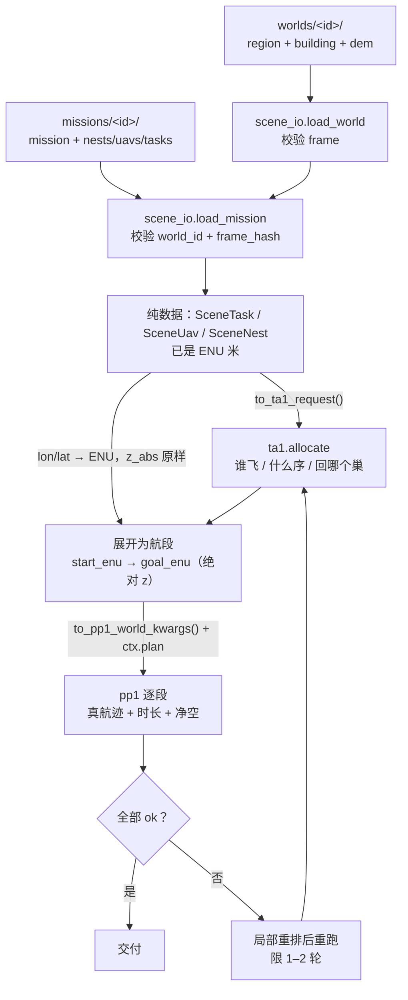

# 0. 数据准备与处理

两套算法吃两套数据，格式完全不同：

- **ta1（任务分配）**：`tasks / uavs / nests` 三个实体表，**内存对象，不读文件**。
- **pp1（路径规划）**：一个世界目录，`region.geojson` + `building/` + `dem.tif`（+ 可选禁飞区）。

但两者**共用同一套局地 ENU 坐标系**（同一进程、同一 frame），所以数据不能按"哪个库读"分开存：
真正要分的是**「变多快 + 属于谁」**——世界（慢变、大）与任务（快变、小）。见 §1。

本文只讲数据：怎么组织、什么格式、怎么自检。算法怎么调见 [`1怎么用-ta1算法.md`](1怎么用-ta1算法.md) / [`2怎么用-pp1算法.md`](2怎么用-pp1算法.md)。

---

## 0. 一页对照

| 项 | ta1 任务分配 | pp1 路径规划 |
|---|---|---|
| 回答什么 | 谁飞、按什么顺序飞、回哪个巢 | 一条航段具体怎么飞（航迹 + 时长 + 净空） |
| 数据在哪 | `data/missions/<id>/`（任务包） | `data/worlds/<id>/`（世界目录） |
| 输入形态 | 内存里的 `Task / UAV / Nest` 对象 | 一个世界目录 |
| 是否读文件 | **不读**（纯计算库） | 读（`load_city` / `create_context`） |
| 存储坐标 | **经纬度是水平真源**，ENU 由 frame 派生 | **经纬度**（EPSG:4326），入库后转 ENU |
| 运行时坐标 | ENU 米，`(x, y, z)` | 入参 ENU 米（含绝对 z） |
| 输出坐标 | ENU 米 | `path_enu` / `trajectory` 为 ENU 米 |
| 高度口径 | 绝对 `z_abs`（与 x/y 同一高程基准） | **同一套绝对 z**：请求收 z，结果给 z |
| 必填 | `mission.json` + `nests/uavs/tasks.json` | `world.json` + `region.geojson` + `building/` |
| 规模量级 | 10² 任务 / 10¹ 机 / 10⁰ 巢（KB 级） | 10⁴ 建筑 / 5 km 见方（MB–GB 级） |
| 单位 | 米、秒 | 米、秒 |
| 校验时机 | `scene_io.load_mission` 一次报全 | 装载期即报错 |

**四条最容易错**：

1. **任务包只写经纬度**。ENU 米由 `world.frame` 现算；直接写 `x/y` 会被加载器拒绝。
2. **一个 task 包只绑一个 world**，靠 `world_id + frame_hash` 声明；frame 对不上直接报错。
3. 高度**从头到尾只有一个口径**：绝对 `z`（与 x/y 同一基准）。`AGL` 是 pp1 库内部按 DEM 派生的校验量，不是接口字段、也不落库。
4. pp1 的 `building/` **不递归**：放进子目录 = 楼静默消失，规划"撞楼"。

---

## 1. 目录怎么组织

### 1.1 为什么是「世界 / 任务」而不是「ta1 目录 / pp1 目录」

按库分目录会制造两个问题：

| 问题 | 具体表现 |
|---|---|
| **frame 断裂** | pp1 的 frame 只由 `region.geojson` 决定；ta1 的输入里没有 frame 字段。两份数据放在平级目录，**没有任何字段能证明它们属于同一坐标系**——塞一份外地坐标进去照样跑，全错也没人知道 |
| **变频率混一起** | 世界是 MB–GB 级、季度更新；任务是 KB 级、每轮都变。混在一起意味着每加一个任务包都要人工重新对齐一次世界 |

所以按**变频率 + 归属**分三层：

### 1.2 目录树

```text
06project-for-uav/
├─ data/
│  ├─ worlds/                              # 大、慢变；一城一份，被多个任务包共享
│  │  └─ guangzhou/
│  │     ├─ world.json                     # world_id / frame / 高程基准 / 数据集指纹
│  │     ├─ region.geojson                 # 必需：frame 的唯一真源
│  │     ├─ building/                      # 必需：顶层 *.shp | *.geojson（不递归）
│  │     │  ├─ Residential.shp/.shx/.dbf
│  │     │  ├─ Commercial.shp/.shx/.dbf
│  │     │  └─ ...                         # 5 个图层，20,670 条记录 → 入库 20,655 栋
│  │     ├─ dem.tif                        # with_dem=true 时必需
│  │     └─ nofly.geojson                  # 可选
│  ├─ missions/                            # 小、快变；一个任务包 = 一次分配的全部输入
│  │  └─ demo_001/
│  │     ├─ mission.json                   # world_id + frame_hash + current_time
│  │     ├─ nests.json / uavs.json / tasks.json
│  │     └─ baseline.json                  # 可选：回归基线（改了数据就重算）
│  └─ contracts/
│     └─ plan_request_example.json          # 两库互操作夹具（契约漂移测试用，不是业务数据）
├─ artifacts/                              # 可选：建场产物（GB 级），跟着世界走；仓库不带，自己 save_field() 生成
│  └─ <world_id>/<label>/                  # sdf.npy + occupancy.npy + meta.json
└─ results/                                # 可选：你自己的输出目录（实验/回归），按世界与任务分层
   ├─ checks/<name>/                       # 库自检，不属于任何任务
   └─ <world_id>/
      ├─ <mission_id>/                     # 某个任务包的跑批输出（含 run_id 子目录更好）
      └─ od_corridor/                      # 世界级实验（OD 走廊多初值）
```

### 1.3 四条归属规则

| 规则 | 理由 |
|---|---|
| 世界目录名 = `world_id` | 换城市只改 `world.root`/`mission.world_id`，不改代码 |
| 任务包只**引用**世界，不复制世界 | 26 MB 建筑只存一份；复制会得到 N 份副本，建筑一改就全部漂移 |
| 场产物跟世界走：`artifacts/<world_id>/<label>/` | 1.1 GB 的 `sdf.npy` 属于这个世界，世界换了就该整个删掉重建 |
| 结果跟世界+任务走：`results/<world_id>/<mission_id>/` | 跑十次也分得清哪份是哪个世界的哪个任务；不同世界的同名任务不会撞在一起 |

> 世界数据整体搬家不会让场产物失效：`dataset_digest` 只看**相对路径 + 内容**，不看绝对路径与 mtime。实测迁移后仍为 `d60b50223a62`。

---

# 第一部分：ta1（任务分配）的数据

## 2. 三个实体

下面是**运行时对象**（库内存里的 `Task / UAV / Nest`）的字段：坐标是**局地 ENU 米**，时间是**秒**。

落盘格式不同——任务包里写**经纬度**，ENU 由 frame 派生（§4）。

### 2.1 `Task`（任务点）

| 字段 | 类型 | 默认 | 含义 / 单位 | 必填 |
|---|---|---|---|---|
| `id` | int | — | 唯一编号，全表不可重复 | ✔ |
| `x` `y` `z` | float | `0.0` | ENU 米；`z` 是绝对高程 | ✔（`z` 可省） |
| `reward` | float | `1.0` | 完成收益，进目标函数 F1 |  |
| `earliest` | float \| None | `None` | 最早可服务时刻（秒，与 `current_time` 同一游标） |  |
| `latest` | float \| None | `None` | 最晚可服务时刻；超出按迟到/违约计 |  |
| `arrival_time` | float | `0.0` | 到达时刻，供上层状态机使用（**本内核不消费**） |  |
| `status` | `TaskStatus` | `PENDING` | 单周期内核只用 `PENDING` |  |
| `sequence_group` | int \| None | `None` | 预留：时序组号 |  |
| `sequence_order` | int | `0` | 预留：组内次序 |  |
| `meta` | dict | `{}` | 透传字段，库不解释 |  |

### 2.2 `UAV`（无人机）

| 字段 | 类型 | 默认 | 含义 / 单位 | 必填 |
|---|---|---|---|---|
| `id` | int | — | 唯一编号 | ✔ |
| `x` `y` `z` | float | `0.0` | **当前所在位置**（起飞点）；同巢起降下应等于所属巢坐标 | ✔ |
| `nest_id` | int \| None | `None` | **归属巢 = 起飞巢 = 终点巢** | ✔（同巢必需） |
| `speed` | float | `10.0` | 巡航速度 m/s，> 0 | ✔ |
| `remaining_range` | float | `1e9` | 本周期可用航程，米；`inf` 视为不限 |  |
| `max_range` | float \| None | `None` | 满电航程，米；`max_time` 缺省时用它推续航（`max_range / speed`） |  |
| `max_time` | float \| None | `None` | 本周期可用续航，秒；给了就以它为准 |  |
| `status` | `UAVStatus` | `IDLE` | **只有 `IDLE` 参与分配** |  |
| `meta` | dict | `{}` | 透传 |  |

### 2.3 `Nest`（机巢）

| 字段 | 类型 | 默认 | 含义 / 单位 | 必填 |
|---|---|---|---|---|
| `id` | int | — | 唯一编号 | ✔ |
| `x` `y` `z` | float | `0.0` | 巢中心坐标（ENU 米） | ✔ |
| `capacity` | int | `10` | 该巢可归属的机体数上限（按 `fleet_uavs` 归属计数） |  |
| `available` | bool | `True` | `False` = 本周期不可用 |  |
| `meta` | dict | `{}` | 透传 |  |

> 任务服务时间不在 `Task` 上，在 `ProblemConfig.default_service_time`（秒，全局统一）。异构服务时间请上层按任务拆分或改配置。

> `sequence_group` / `sequence_order` 与 `ProblemConfig.constraints.sequence` / `sync` 目前是**预留字段**：字段可传，但本内核不消费、也不做校验。有时序依赖的任务（如"先侦察后投送"）请在上层拆成两次调用，不要指望这两个字段生效。

## 3. 同巢起降对数据的 4 条硬要求

| # | 要求 | 不满足会怎样 |
|---|---|---|
| 1 | 每架机 `nest_id` 非空，且该巢在 `nests` 里存在 | 装不出航次终点；该机被判不可用/不进解 |
| 2 | 建议 `uav.x/y/z` = 所属巢坐标 | 不报错，但起点与终点不是同一点，图上不闭合、航程账偏小 |
| 3 | **每个巢**归属的机数 ≤ 该巢 `capacity`（按 `fleet_uavs` 全部机体计，不是只算参与机） | 报 `nest_overcapacity_<id>`，解不可行 |
| 4 | 一架机只属于一个巢 | 没有跨巢轮转；要换基地就改 `nest_id` 再调一次 |

同巢起降**删除**了"末任务飞往另一个巢"的自由度，所以：不许出现"机体在某巢、`nest_id` 指向另一巢"的数据；那不会崩，但会得到一架从 A 起飞、绕回 B 的机（判为 `home_return_violation`）。

## 4. 落盘格式：任务包四件套

一个任务包住 `data/missions/<mission_id>/`，**只写经纬度**，ENU 由 `world.frame` 现算。

### 4.1 `mission.json`（绑定世界 + 时间基准）

```json
{
  "mission_id": "demo_001",
  "schema": 1,
  "world_id": "guangzhou",
  "frame_hash": "59ccbad38a06",
  "current_time": 0.0,
  "time_base": "relative_s",
  "z_basis": "absolute_enu_z",
  "solver": { "pop_size": 24, "max_generations": 60, "seed": 0 }
}
```

| 字段 | 必填 | 说明 |
|---|---|---|
| `world_id` | ✔ | 必须是 `data/worlds/` 下的目录名 |
| `frame_hash` | ✔ | 该任务包坐标所属 frame 的指纹；与 `world.json` 对不上直接报错 |
| `current_time` |  | 本周期起始时刻（秒），缺省 0 |
| `time_base` |  | 只支持 `relative_s`（相对本周期起点，不是绝对时间戳） |
| `z_basis` |  | 只支持 `absolute_enu_z`（AGL 不落库） |
| `solver` |  | 直接透传 `SolverConfig.from_dict` |
| `problem` |  | 可选，透传 `ProblemConfig.from_dict`（服务时间、约束开关、权重等） |
| `cost` |  | 可选，透传 `CostConfig.from_dict`：`model`（`euclid3d` / `vertical_section`）、`agl_min_m`/`agl_max_m`、`clearance_m`、`climb_rate`、`num_samples`；选 `vertical_section` 时还需给采样器，见 `1怎么用-ta1算法.md` §3.2 |

分配想用垂直切面尺子时，追加这一段（不写则三维欧氏）：

```json
"cost": { "model": "vertical_section", "agl_min_m": 10, "agl_max_m": 120,
          "clearance_m": 5, "climb_rate": 0.15, "num_samples": 200 }
```

采样器只能由代码给（地面与建筑包络是数据，不是配置）：`scene_io.to_ta1_cost_samplers(world)` 从世界目录现造，或你自己实现两个 `(xs, ys) -> 绝对 z` 序列。

不落任务包、直接调 `ta1.allocate()` 的服务端，用整包配置示例 `ta1_full_config.example.json`（同目录 `.jsonc` 带注释），三段 `solver` / `problem` / `cost` 与这里同名等价。

### 4.2 `nests.json` / `uavs.json` / `tasks.json`

```json
[
  { "id": 0, "name": "nest_0", "lon": 113.291092884, "lat": 23.073499711,
    "z_abs": 8.0, "capacity": 4, "available": true },
  { "id": 1, "name": "nest_1", "lon": 113.320391, "lat": 23.078021,
    "z_abs": 7.66, "capacity": 4, "available": true }
]
```

```json
[
  { "id": 0, "nest_id": 0, "lon": 113.291092884, "lat": 23.073499711, "z_abs": 8.0,
    "speed": 15.0, "remaining_range": 18000.0, "max_time": 2400.0, "status": "IDLE" }
]
```

```json
[
  { "id": 100, "lon": 113.299180, "lat": 23.077118, "z_abs": 48.37,
    "reward": 1.0, "earliest": 0.0, "latest": 1200.0 }
]
```

规则：

- 水平坐标**只认 `lon` / `lat`**；写 `x` / `y` 会被加载器拒绝（提示用 `frame.to_lonlat` 反算）；
- `z_abs` 是**绝对高程**（米），pp1 请求也收绝对 z——原样传，不要先减地面；
- `uav` 的经纬度建议与所属巢一致（同巢起降的起点就是巢）；
- 巢 `capacity` 按**归属机数**计（含 `BUSY / CHARGING / FAULT`），不是按降落时刻。

### 4.3 `baseline.json`（可选，回归基线）

```json
{
  "world_id": "guangzhou", "frame_hash": "59ccbad38a06",
  "dataset_digest": "d60b50223a62", "distance": "euclidean3d",
  "solver": { "pop_size": 24, "max_generations": 60, "seed": 0 },
  "expect": { "feasible": true, "home_return_ok": true, "n_executed": 3,
              "path_m": 4501.944743, "return_leg_m": 1456.536412 },
  "tolerance": { "abs": 1e-06 }
}
```

改了世界数据、参数或距离口径，这个基线就必须重算——它是"这次改动有没有改变解"的唯一证据。

## 5. 加载：`scene_io`（不属于任何算法库）

三条硬约束，先记住再往下看：

| 约束 | 含义 |
|---|---|
| **两库各自独立** | ta1 与 pp1 互不 import，各自能单独安装、单独使用 |
| **加载器不进库** | ta1 是纯计算库不读文件；pp1 只读它自己的世界目录 |
| **`scene_io` 零依赖** | 只用标准库，**不 import** ta1 / pp1；对接靠数据契约 + 懒加载桥 |

```text
scene_io     ← 零依赖（标准库）
ta1  pp1     ← 各自独立，互不 import
对接         ← 同一套 ENU 米 + frame_hash + bridges 里的懒加载函数
```

```python
import scene_io
import task_allocation1 as ta1      # 只在你真要用 ta1 时才装、才 import

world = scene_io.load_world("data/worlds/guangzhou")          # 校验 frame ↔ region
m = scene_io.load_mission("data/missions/demo_001", world=world)

print(m.summary())
# {'mission_id': 'demo_001', 'world_id': 'guangzhou', 'frame_hash': '59ccbad38a06',
#  'n_tasks': 3, 'n_uavs': 2, 'n_nests': 2, 'current_time': 0.0}

print(m.tasks[0].x, m.tasks[0].y)          # 已换算成 ENU 米（纯 float，不是任何库的类型）

res = ta1.allocate(scene_io.to_ta1_request(m))    # 默认欧氏距离
print(res.metrics_dict()["home_return_ok"])
```

接 pp1 用同一份世界（**只回一个 dict，连 import 都不需要**）：

```python
import path_planning1 as pp1
ctx = pp1.create_context({"world": scene_io.to_pp1_world_kwargs(world, max_od_length_m=3000.0)})
```

> 想给自己留个硬约束：只用 ta1 的服务不必装 shapely/casadi，只用 pp1 的服务不必装 ta1。
> 所以 `scene_io` 的 `pyproject` 里 `dependencies = []`，两个库只出现在**可选**组
> （`[ta1] / [pp1]`）里，`import scene_io` 不会拉起任何算法库——有测试专门守这条。

### 5.1 加载期挡掉什么

`load_mission` **一次报出全部问题**（不是逐条抛）：

| 检查 | 报错示例 |
|---|---|
| `world_id` 与目录不符 | `world_id 不匹配：mission='x' ↔ world='guangzhou'` |
| `frame_hash` 对不上 | `frame_hash 不匹配：mission='…' ↔ world='…'`（坐标不是这个 frame 算的） |
| 缺 `lon/lat` 或用了 `x/y` | `tasks.json[0] 用了 x/y（ENU 米）：任务包只收 lon/lat` |
| 缺 `z_abs` | `缺少 z_abs（绝对高程，米；不是 AGL）` |
| `id` 重复 / `nest_id` 不存在 | 逐条列出行号 |
| 某巢归属机数 > `capacity` | `巢 0 归属 5 架机，超过 capacity=4` |
| `time_base` / `z_basis` 取值不支持 | 只支持 `relative_s` / `absolute_enu_z` |

### 5.2 世界自洽校验

`load_world` 会做两件事，任一失败即报错：

1. `world.json` 里的 `frame_hash` 必须等于按其 `frame` 现算的值；
2. 该 frame 必须等于从 `region.geojson` 现算的 frame（**frame 唯一真源**）。

`frame_hash` 口径固定为 `sha1(f"{lon0:.9f},{lat0:.9f},{lat_ref:.9f}")[:12]`——任何一侧自己算都必须用这一行。

`world.dataset_digest` 是数据指纹（建筑/DEM/禁飞区内容）。它由 pp1 的 `dataset_digest()` 产出，
`scene_io` **不重复实现**它（要 import shapely/pyshp，会破坏零依赖）；需要深度复核时用
`scene_io.check_world_with_pp1(world)`——测试/CI/入库时跑，不进请求路径。


## 6. 距离口径怎么给

`AllocateRequest.distance_fn` 是 `(Position, Position) -> float`，**有向**，单位米。缺省三维欧氏。

| 场景 | 怎么给 |
|---|---|
| 只要排序合理性、离线路演 | 不传，用欧氏 |
| 有路网/代价矩阵 | 传自己的查表函数，命中不到时回退欧氏 |
| 要贴合真实可飞性 | 传 pp1 的 L0/L1 估算（见 [`3任务分配-路径规划对接.md`](3任务分配-路径规划对接.md)） |

```python
import math

def horizontal(pos_a, pos_b):          # 只算水平距离，忽略高度差
    return math.dist(pos_a[:2], pos_b[:2])

req = ta1.AllocateRequest(tasks=..., uavs=..., nests=..., distance_fn=horizontal)
```

注意：

- 距离函数必须**纯、稳定、无随机**，同一个键反复问必须返回同一个值，否则搜索会自相矛盾。
- 如果距离函数很贵，上层自己做缓存（键 = 两个坐标元组），库不缓存。
- 换了距离口径，**旧结果不可比**，报告里要记一句。

## 7. 自检清单（ta1）

- [ ] `mission.json` 里的 `world_id` 与 `frame_hash` 都存在，且指向真实世界
- [ ] 所有点都写的是 `lon/lat`（不是 `x/y`），落在 `region.geojson` 的 bbox 内
- [ ] `z_abs` 是**绝对高程**，与世界的 DEM 同一基准（不是 AGL、不是相对地面高度）
- [ ] `id` 在各自表内唯一；`uav.nest_id` 都能在 `nests` 里找到
- [ ] 每架机的经纬度与所属巢一致（否则同巢不闭合）
- [ ] 每个巢归属机数 ≤ `capacity`（含 `BUSY / CHARGING / FAULT` 的机体，`fleet_uavs` 一并计入）
- [ ] `speed > 0`；`remaining_range` 与实际续航匹配（不是 `1e9` 兜底就完事）
- [ ] `earliest ≤ latest`；时间基准与 `current_time` 同一游标（别一个用「当天 0 点」一个用「本周期起点」）
- [ ] `scene_io.load_mission(...)` 能过（它会一次列出所有数据问题）
- [ ] 返回后核对 `res.home_return_ok == True`、`res.metrics_dict()["feasible"]`；有 `baseline.json` 就对一遍

---

# 第二部分：pp1（路径规划）的数据

## 8. 最小集

```text
<world_root>/
├─ region.geojson      # 必需
├─ building/           # 必需，顶层
│  ├─ *.shp + *.shx + *.dbf     # 格式 A（.prj 可选，代码不读）
│  └─ *.geojson                 # 格式 B（UTF-8）
├─ dem.tif             # with_dem=true 时必需
└─ nofly.geojson       # 可选
```

建筑**两种格式二选一**，不要同一批楼同时放两份——会被读两遍，楼算两层。

## 9. `region.geojson`

| 项 | 要求 |
|---|---|
| 格式 | GeoJSON `FeatureCollection` |
| 几何 | Polygon / MultiPolygon，取并集外接矩形 |
| 坐标 | **EPSG:4326 经纬度，顺序 `[lon, lat]`** |
| `properties` | 不参与规划 |

它决定三件事：局地 frame 原点（bbox 左下角）、`bounds_m`、全域场水平范围。

- 经纬度写反**可能仍落在合法范围**，不会报错 → 一定要肉眼在地图上确认一次。
- 用**紧凑运营区**，不要直接甩行政区：bbox 是外接矩形，狭长/弯月区会把角落也纳入。
- 局地切平面近似只适用于跨度 < 25 km；更大就拆子区、各建一个 context。

## 10. `building/*.shp` 与 `building/*.geojson`

| 项 | Shapefile | GeoJSON |
|---|---|---|
| 文件 | `.shp` + `.shx` + `.dbf` 必需 | 单个 `.geojson`，UTF-8 |
| 扫描 | `building/` **顶层**，不递归 | 同左 |
| 几何 | Polygon / MultiPolygon（2D footprint） | 同左 |
| 坐标 | EPSG:4326 经纬度（按 bbox 自检） | EPSG:4326（逐点自检） |
| 高度字段 | DBF 字段 `Height`，**GBK** 解码 | `properties.Height` |
| 高度值 | **有限正数，米，相对地面** | 同左 |
| 面积过滤 | `world.min_area_m2`，默认 `1.0` | 同左 |
| 其他字段 | 全部忽略 | 全部忽略 |

代码对两种格式的**共同处理**：MultiPolygon 只取面积最大的一个 Polygon；内环（院子/天井）按实体填实（保守）；高度非正/`NaN`/`Inf` 直接 `ValueError`；过滤后一栋不剩也直接 `ValueError`（防"空世界静默 ok"）。

实测样例（`data/worlds/guangzhou`）：

| 图层 | 记录数 | 字段（节选） |
|---|---:|---|
| Residential | 6,648 | `Height`, `id`, `Height_1`, `label` |
| Commercial | 6,528 | 同上 |
| PublicServices | 2,367 | 同上 |
| EducationalCultural | 940 | 同上 |
| TechnologyIndustry | 4,187 | 同上 |
| **合计入库** | **20,655** | 高度 1.2 – 224.5 m |

GeoJSON 最小示例（高度在 `properties` 里，不是顶层字段）：

```json
{
  "type": "FeatureCollection",
  "features": [{
    "type": "Feature",
    "properties": { "Height": 28.5 },
    "geometry": {
      "type": "Polygon",
      "coordinates": [[
        [91.130, 29.650], [91.131, 29.650],
        [91.131, 29.651], [91.130, 29.651], [91.130, 29.650]
      ]]
    }
  }]
}
```

**高度口径只有一条**：

```text
Height        = 建筑相对地面的高度（米，> 0）
base_z_m      = footprint 顶点 + 中心处 DEM 的最大值
z_top_m       = base_z_m + height_m
```

源数据常见三种坏情况：

| 源情况 | 处理 |
|---|---|
| 只有楼层数 `building:levels` | `Height = levels × 3.0`，并在数据说明里记下这个假设 |
| 给的是"楼顶海拔" | 先减去该楼地面高程，再写进 `Height`；否则会被 DEM 再加一次 |
| 空值 / `"12m"` / `"12.5米"` / `NaN` | 无法解析 → 启动即报错，必须清洗成纯数字 |

字段名**大小写敏感**。源字段叫 `height` / `HEIGHT` / `楼高`，就配 `"height_field": "height"`。

## 11. `dem.tif`

| 项 | 要求 |
|---|---|
| 格式 | GeoTIFF，单波段 |
| 坐标 | EPSG:4326 经纬度（代码不校验 CRS，自己保证） |
| 标签 | 必须保留 `33550`（PixelScale）+ `33922`（ModelTiepoint） |
| 单位 | 米，不是英尺 |
| 基准 | 与建筑 `base_z`、禁飞区绝对 `z` **同一套高程基准** |
| 覆盖 | 必须盖住 `region bbox + field_pad` + 全部建筑 |

读取逻辑：`PixelScale` 推像元大小、`Tiepoint` 定左上角、NoData 用最近邻有效值填、双线性采样、**域外 clamp 到边缘值不外推**。

> 域外 clamp 是**静默错误**：DEM 没盖住某栋楼时不会报错，只会拿边缘值当地面，楼底矮一截。所以覆盖检查必须在数据侧做。

实测样例：`shape=(157, 172)`，高程 `2 – 75 m`，建筑 `base_z` 落 `4.3 – 74.3 m`。

## 12. `nofly.geojson`（可选）

| 项 | 要求 |
|---|---|
| 几何 | Polygon / MultiPolygon，**不支持洞**（有洞请拆成多个） |
| 坐标 | EPSG:4326 |
| `absolute` 模式（默认） | `properties.z_min_m` / `z_max_m`：**绝对高程** |
| `agl` 模式 | `properties.agl_min_m` / `agl_max_m`：**真高**，必须同时给，且 `with_dem=true` |
| 约束 | 两种字段不可混用；各多边形必须 `min < max` |

- 禁飞棱柱可以**悬浮**，上下都可绕；
- 端点落进棱柱 → `endpoint_in_nofly`；
- 时间窗禁飞不在库内：服务层按任务时刻冻结一份静态集合再传；
- 没有禁飞数据就**不要放文件**，放了空的/错的反而报错。

**高海拔地区的关键坑**：`absolute` 模式下 `z_min_m / z_max_m` 是绝对高程。地面 3,600 m 的城市若照默认写 `0 / 1000`，禁飞层整个落在地面以下，**什么也挡不住**。要么写绝对高程，要么改用 `agl` 模式。

## 13. 数据预检（不建场）

```python
import math
# 预检不建场，只能走子包：pp1 顶层门面没有"只读数据集"的入口。
# 生产路径一律 pp1.create_context()，不要照抄这两行去接服务。
from path_planning1.core.city_dataset import load_city
from path_planning1.core.params_config import world_kwargs_from_config

cfg = {"world": {"root": "data/worlds/guangzhou", "with_dem": True}}
ds = load_city(**world_kwargs_from_config(cfg))

print("buildings:", len(ds.buildings))
print("bounds_m:", [round(v, 1) for v in ds.bounds_m])
print("diag_m:", round(math.dist(ds.bounds_m[:2], ds.bounds_m[2:]), 1))
print("height_m:", round(min(b.height_m for b in ds.buildings), 1),
      "-", round(max(b.height_m for b in ds.buildings), 1))
if ds.dem is not None:
    print("dem:", ds.dem.z_m.shape,
          round(float(ds.dem.z_m.min()), 1), "-", round(float(ds.dem.z_m.max()), 1))
```

判读标准：

- `diag_m` 超过 25 km → 拆子区，别塞进一个 frame；
- `height_m` 上千 → 把"楼顶海拔"写进了 `Height`；
- `dem` 高程与当地实际同量级（不是 0–100，也不是英尺数字）；
- `bounds_m` 与运营需求匹配（样例：4,845.9 × 4,793.6 m，对角线 6,816 m）。

## 14. 自检清单（pp1）

- [ ] 世界目录有 `world.json`，且其 `frame` 与 `region.geojson` 一致（`scene_io.load_world` 会验）
- [ ] `region.geojson` 是 EPSG:4326、`[lon, lat]`、bbox 紧凑
- [ ] `building/` 是顶层文件，`.shp/.shx/.dbf` 齐全、DBF 为 GBK；或单个 `.geojson`（UTF-8）
- [ ] 没有同一批楼同时存在 `.shp` 与 `.geojson`
- [ ] `Height` 字段名对得上、有限正数、米、相对地面
- [ ] `dem.tif` 是 EPSG:4326、米制、含 `33550` / `33922`
- [ ] DEM 覆盖 `region bbox + pad` + 全部建筑
- [ ] `nofly.geojson`（如有）无洞、字段不混用、`min < max`、绝对 z 或 AGL 与所选模式一致
- [ ] 数据/配置一改，旧场产物与缓存全部重建，`world.json` 的 `dataset_digest` 一并更新

---

# 第三部分：两套算法怎么共用一套坐标

## 15. 高度：一个口径，三个量

| 量 | 定义 | 出现在哪里 |
|---|---|---|
| 绝对 `z` | ENU 高度，与 x/y 同一基准 | **唯一对外口径**：`tasks.json` 的 `z_abs`、pp1 请求 `start_z_m/goal_z_m`、pp1 结果 `path_enu` / `trajectory` |
| 地面 `z_ground(x,y)` | DEM 采样值 | pp1 内部 |
| 真高 `AGL` | `z − z_ground` | 只在两个地方：配置的飞行带 `agl_min_m/agl_max_m`（业务约束），结果里顺便报的 `agl_min_m/agl_max_m` |

规则：**一律用绝对 z；AGL 只在库内部派生，输入输出都不出现。**

## 16. 字段对照

| 任务包字段 | pp1 对应 | 怎么转 |
|---|---|---|
| `task.lon/lat` | `goal_xy` | `frame.to_local(lon, lat)`（同一 frame，**不要**用两套换算） |
| `task.z_abs` | `goal_z_m` | 原样传（同一个绝对口径） |
| `uav.lon/lat` | `start_xy` | 同 `task` |
| `uav.z_abs` | `start_z_m` | 同上 |
| `nests[].lon/lat` | 无直接对应 | 只用于 ta1 的起点/终点；pp1 不知道巢 |
| `distance_fn` 的一条边 | 一次 `ctx.plan` | 分配阶段用代理（欧氏/切面），交付阶段逐段真规划 |

**两库不共享 python 模块**，只共享三样东西：同一套 ENU 米、同一个 `frame_hash`、同一个 `world.json`。frame 由 `region.geojson` 唯一决定，ta1 不自己定义 frame，也不 import pp1。

## 17. 数据流



图中 `scene_io` 只是"翻译"：它不 import 两个库，两个库也不 import 它。

---

## 18. 处理顺序（按这个顺序做）

1. **定运营区**：裁一个 5–12 km 的紧凑 `region.geojson`，看 bbox 对角线。
2. **建筑**：裁到运营区、高度统一为米/正数/相对地面、字段名 ASCII、碎片过滤、格式二选一。
3. **DEM**：转 EPSG:4326、转米、填 NoData、确认覆盖、`gdalinfo` 看两个标签。
4. **禁飞区**（可选）：选 `absolute` 或 `agl` 口径，字段不混写。
5. **写 `world.json`**：`world_id` + frame（锚点 bbox 左下角、`lat_ref` 取 bbox 中心纬度）+ `dataset_digest`；用 `scene_io.load_world` 验一遍。
6. **pp1 预检 + 小区域建场**：看 `field.shape` / `nbytes` 可接受再扩；产物落 `artifacts/<world_id>/`。
7. **写任务包**：`mission.json` 填 `world_id` + `frame_hash`，点名用 `lon/lat` + `z_abs`，`nest_id` 补齐，时间基准对齐。
8. **ta1 冒烟**：`scene_io.load_mission` 过一遍，3–5 个任务、2 架机跑通，看 `home_return_ok`。
9. **存基线**：跑一次把指标写进 `baseline.json`，以后改数据先对基线。
10. **对接待验证**：抽样航段比 ta1 代理排序与 pp1 真值排序（Kendall τ / top-k）。

坐标转换常用命令：

```bash
ogr2ogr -t_srs EPSG:4326 -lco ENCODING=GBK out.shp in_utm.shp    # Shapefile，DBF 用 GBK
ogr2ogr -t_srs EPSG:4326 out.geojson in_utm.shp                  # GeoJSON，UTF-8
gdalwarp -t_srs EPSG:4326 -r bilinear in_dem.tif dem.tif         # DEM
ogrinfo -al -so out.shp && gdalinfo dem.tif                      # 复核
```

---

## 19. 常见报错

| 报错 / 现象 | 大概率原因 | 处理 |
|---|---|---|
| `ValueError: ... 不是经纬度（度）` | `.shp` / `region.geojson` 还是投影米坐标 | 转 EPSG:4326 |
| `ValueError: 高度字段 'Height' 缺失或非正` | 字段名错、空值、0、文本、`NaN`/`Inf`、绝对顶高程 | 按 §10 清洗 |
| `ValueError: 没有可用建筑` | `building/` 空、几何是点/线、高度全非法、全被面积过滤 | 核对文件/字段/几何 |
| `ValueError: 没有 GeoTIFF 地理标签（33550/33922）` | DEM 不是标准 GeoTIFF 或转换丢标签 | `gdalwarp` 重出 |
| `FileNotFoundError: 缺少区域轮廓/建筑目录/dem.tif` | 目录结构不对或 `with_dem=true` 却没 DEM | 按 §8 补齐 |
| `FieldContractError: 窗口...超出全域场` | 场覆盖不足、`max_od`/pad/region 变过、产物过期 | 重建场 |
| `outside_world` / `od_too_long` | 端点出 bbox / 单段超 `max_od_length_m` | 查坐标换算；拆航段 |
| `out_of_flight_band` | 端点 z 换算出的 AGL 不在 `[agl_min_m, agl_max_m]`（含 z 低于地面） | 看报错里的 z / 地面 / AGL 三个数 |
| `endpoint_in_nofly` / `start_or_goal_blocked` | 端点落禁飞棱柱 / SDF 净空不足 | 改端点；查禁飞绝对 z |
| `rrt_no_path` / `roi_no_path` | 走廊太窄、净空太大、分辨率不匹配 | 调 ROI/净空，别只加迭代 |
| ta1 解出"从 A 起飞、回 B" | 该机 `nest_id` 与坐标不一致 | 对齐 `nest_id` 与巢坐标 |
| ta1 全程满足但航程明显偏小 | 把经纬度当米传了 | 检查坐标量级 |
| `world_id 不匹配` / `frame_hash 不匹配` | 任务包不是用这个世界的 frame 算的 | 重算经纬度，或换 `world_id` |
| `任务包只收 lon/lat` | 写了 ENU 的 `x/y` | 用 `world.frame.to_lonlat(x, y)` 反算 |
| `缺少 z_abs（绝对高程…）` | 只给了 AGL 或相对高度 | 补 `z_abs = DEM + AGL`（数据侧唯一要做这个加法的地方） |
| `巢 X 归属 N 架机，超过 capacity` | 机队规模超过巢容量 | 加巢、加容量或减机 |
| `缺 world.json` | 世界目录没写描述 | 补 `world.json`（§1.2） |

---

## 20. 高海拔 / 大起伏地区的额外注意

只影响 pp1（ta1 只关心米与秒，与海拔无关）：

- **请求传绝对 z**：地面 3,600 m 时“离地 25 m”就是 `z≈3,625`，pp1 请求传 3,625，不要传 25。
  飞行带 `agl_min_m/agl_max_m`（默认 10/120）仍是离地高度，由库内按 DEM 换算。
- **禁飞区默认 `absolute`**：必须写绝对高程，否则落在地面以下。
- **场内存会膨胀**：竖向包络 = 最低地面到最高楼顶，山地城市 `nz` 可能是平原的数倍。先截小核心区看 `ctx.field.nbytes` 再扩。
- **DEM 精度决定一切**：90 m 全球 DEM 不适合做建筑级净空，城市低空尽量 5–30 m。

---

## 21. 和其它文档的关系

四份文档按 **0 数据 → 1 ta1 → 2 pp1 → 3 对接** 的顺序读，每份都能单独看：

| 文档 | 用途 | 前置 |
|---|---|---|
| **本文（0）** | 数据怎么组织、什么格式、怎么自检 | — |
| [`1怎么用-ta1算法.md`](1怎么用-ta1算法.md) | **ta1 单独用**：调用、同巢口径、距离注入、结果字段 | 只需本文「第一部分」 |
| [`2怎么用-pp1算法.md`](2怎么用-pp1算法.md) | **pp1 单独用**：配置、建场、请求、结果、失败码 | 只需本文「第二部分」 |
| [`3任务分配-路径规划对接.md`](3任务分配-路径规划对接.md) | **两者对接**：契约、代理排序验收、失败回环 | 两份都读过 |
| [`../scene_io/README.md`](../scene_io/README.md) | 数据适配层：零依赖、frame 校验、两座桥 | — |
| [`../task_allocation1/README.md`](../task_allocation1/README.md) | ta1 算法三段、模块地图 | — |
| [`../path_planning1/README.md`](../path_planning1/README.md) | pp1 算法主线、参数体系、基线 | — |
| [`pp1_full_config.example.jsonc`](pp1_full_config.example.jsonc) | pp1 全量配置（带注释） | — |

**一句话：ta1 的难点是"单位与同巢口径"，pp1 的难点是"高程口径 + 数据覆盖 + 场规模"。这两件事在调参之前必须先做对；对接本身不该有难点——两边只共享一份数据契约。**
