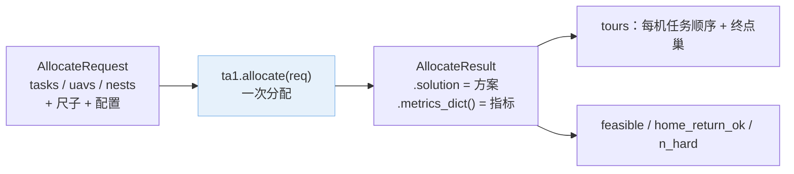
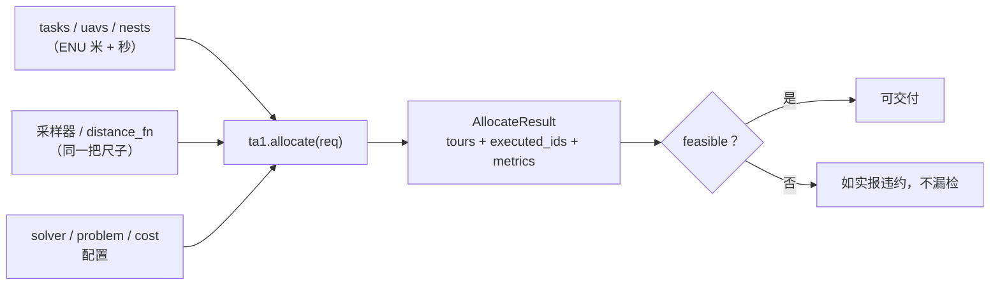
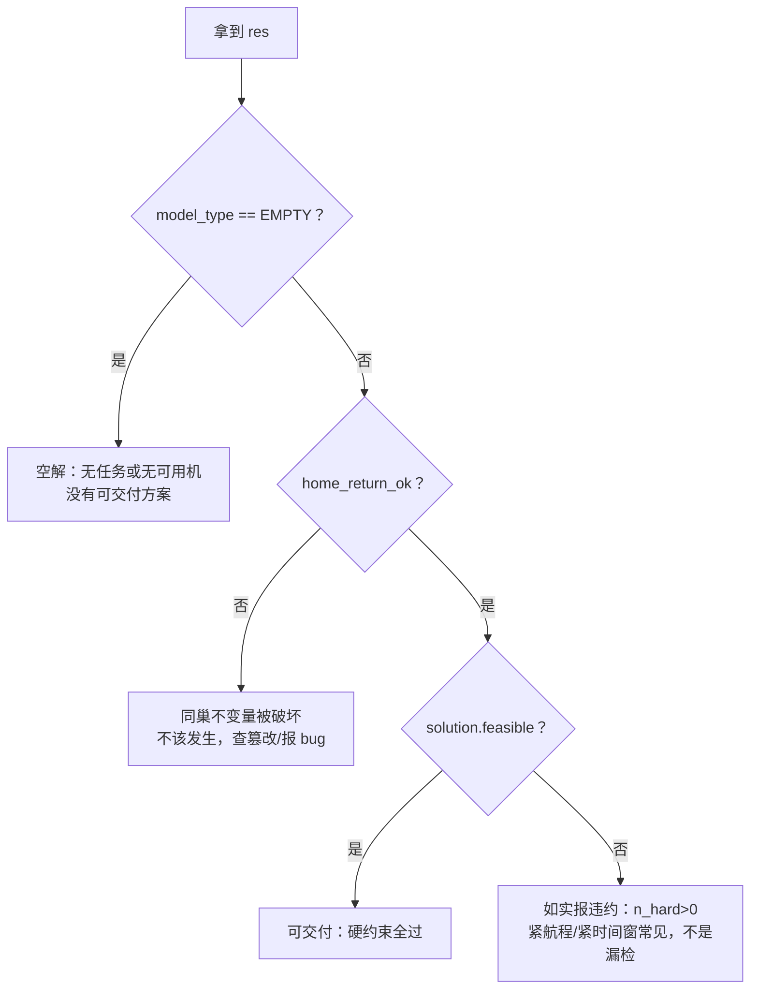

# 后端接入 ta1（task_allocation1）

> 读者：后端工程师 / 联调方。
> 目标：用最少的代码把 ta1 接进服务——构造一次请求、拿回分配方案、读懂结果、配好尺子。
> 版本：v0.2.0 ｜ `ALGORITHM_ID = "ta1-dmde-home-nest"` ｜ pip 发行名 `uav-task-allocation1`，导入名 `task_allocation1`。
> 本文只讲**怎么用**；算法三段主线与模块地图见 `../task_allocation1/README.md`，与路径层的对接见 `3任务分配-路径规划对接.md`。

> **ta1 是独立库**：不需要 pp1、不需要数据目录。你在内存里给三张表（任务 / 无人机 / 机巢），它返回
> "谁飞、按什么顺序飞、回哪个巢"——**终点恒等于起飞巢**。真航迹与真时长是 pp1 的事，ta1 不算。

---

## 1. 先介绍：这个库是什么

### 1.1 一句话

给一批待办任务、一批无人机、一批机巢，返回一张**分配方案**：每架机从自己的巢出发、按顺序做几个任务、最后回到同一个巢。

- **输入**：`tasks` / `uavs` / `nests` 三个内存列表（局地 ENU 米 + 秒）+ 一把"量米数"的尺子 + 配置。
- **输出**：`AllocateResult`——每架机的任务顺序（`tours`）、本周期交付哪些任务、可行性诊断、可序列化指标。
- **硬规矩**：非空航次 `end_nest_id == start_nest_id == uav.nest_id`，没有开关可以关掉。
- **它是纯计算**：一次调用 = 一次分配，不读文件、不联网、不落库、无全局随机状态；随机性由 `seed` 注入，同种子逐位可复现。

### 1.2 它不负责什么

| 不负责 | 归谁 |
|---|---|
| HTTP / 缓存 / 队列 / 超时 / 落库 / 序列化 | 你的服务 |
| 真航迹、真时长、禁飞区、净空终检 | pp1（落地层），见 `3任务分配-路径规划对接.md` |
| 任务流到达、跨周期滚动、休眠唤醒、事件重规划 | 服务层（有状态） |
| 风场、能耗最优、动态禁飞 | 未实现 |

**边界**：`import task_allocation1 as ta1` 是唯一对外门面；顶层 `__all__` 里的名字才是交付面，
`task_allocation1.core.*` 是内部实现，不要从深路径接服务。核心不读 DEM / 文件；有地形走
`ta1.terrain` 或注入采样器，没地形自动走欧氏。

### 1.3 三个核心对象

| 对象 | 什么时候用 | 作用 |
|---|---|---|
| `AllocateRequest` | 每次调用构造一个 | 装输入：三张表 + 尺子 + 配置 |
| `ta1.allocate(req)` | 每次调用一次 | 唯一入口，跑一次分配，返回结果 |
| `AllocateResult`（`res`） | 每次调用得一个 | 结果：方案 `solution` + 诊断 + 指标 |

三者关系：**构造一个 `req`，调一次 `allocate`，拿回一个 `res`**；`res.solution` 里才是真正的方案（`tours` / `executed_task_ids`）。



### 1.4 一次分配的数据流

三张内存表进去，一个结果对象出来；**距离尺子贯穿代价、ETA、航程所有米数**——这是理解 ta1 的关键：分配阶段的米数都出自同一把尺子，是排序用的代理值，不是真航程。



### 1.5 先记住几个词

第一次读先看这张表，否则后面的术语容易混。凡是"米"，在 ta1 里都指**代理米数**（尺子估的排序值），不是真飞出来的距离。

| 词 | 白话含义 | 对应字段 / 参数 |
|---|---|---|
| **tour / 航次** | 一架机的一次出行：巢 → 几个任务 → 回巢 | `res.solution.tours`，每条给 `uav_id`、`task_ids`、`end_nest_id` |
| **同巢起降** | 从哪个巢起飞就回哪个巢，终点不是自由选的 | `end_nest_id == start_nest_id`；`home_return_ok` |
| **代理尺子** | 分配时"量米数"的尺子，只为排序，不是真航程 | `distance_fn` 或 `cost_config` |
| **硬违约** | 绝对不能犯的错，犯了解就不可行 | `n_hard`、`feasible` |
| **软代价** | 可以犯但要扣分，比如迟到每多一秒多罚一点 | `w_late`（迟到 `0.01/s`） |
| **ζ（zeta）** | DMDE 动态交叉率的曲率指数，控制搜索怎么收敛，默认 3 | `SolverConfig.zeta` |
| **λ（lambda）** | 航程在总分里的权重，越大越倾向省路程，默认 0.1 | `ProblemConfig.lambda_cost` |
| **κ（kappa）** | 硬违约的罚分倍率，默认 10，让硬违约绝不被"忍过去" | `hard_violation_kappa` |
| **f2 / path_m** | 航程目标值 / 总航程米数（同一来源） | `f2_cost` / `metrics_dict()['path_m']` |
| **f1** | 交付任务的奖励和，只做事后指标，**不进搜索目标** | `f1_reward` |
| **polish** | 交付前最后一轮局部微调（跨机换任务 / 换顺序），四道门把关、无随机 | `SolverConfig.polish_enabled` |
| **DMDE** | 一种差分进化搜索算法（代价空间差分 + 温度退火反映射），是 ta1 的搜索内核 | 内部，一般不用调 |

一句话记住口径：**完成是约束、成本是目标**——"做完任务"是必须满足的硬条件，"路程短"才是要优化的目标；奖励 f1 不参与搜索，只做事后统计。

---

## 2. 教学：从零跑通一次分配

### 2.1 安装

在仓库根执行（任选其一）：

```bash
# 使用（装成包）
pip install "./task_allocation1"

# 开发（可编辑安装，改代码即时生效）
uv pip install -e task_allocation1

# 验证导入
python -c "import task_allocation1 as ta1; print(ta1.__version__, ta1.ALGORITHM_ID)"
# 0.2.0 ta1-dmde-home-nest
```

> ta1 没有 `[nlp]` 之类的可选依赖（那是 pp1 的）；地形读取用的 `terrain` 子模块随包安装。

### 2.2 最小调用

三张表直接构造，不需要文件或 pp1：

```python
import task_allocation1 as ta1

req = ta1.AllocateRequest(
    tasks=[ta1.Task(id=0, x=0, y=0, reward=1.0, latest=3600),
           ta1.Task(id=1, x=800, y=0, reward=1.0, latest=3600)],
    uavs=[ta1.UAV(id=0, x=0, y=0, nest_id=0, speed=15.0, remaining_range=1e5)],
    nests=[ta1.Nest(id=0, x=0, y=0, capacity=4)],
    distance_fn=ta1.euclidean3d,                    # 无地形可不传，默认自动欧氏；有地形改采样器（§3.2）
    solver_config=ta1.SolverConfig(pop_size=30, max_generations=100, seed=42),
)
res = ta1.allocate(req)

res.solution.executed_task_ids   # 本周期交付的任务
res.solution.tours               # 每架机的航次：task_ids + end_nest_id
res.home_return_ok               # True = 每条非空航次都回到起飞巢
res.metrics_dict()               # 扁平指标，可直接序列化
```

空输入（无任务或无可用机）不抛异常，返回 `model_type=EMPTY` 的空解。

### 2.3 读结果：先分三种情况

下面 `log` 是示例占位，换成你们自己的日志。`feasible` 已经包含同巢判定，但仍建议独立核对一遍。



```python
if res.model_type.value == "empty":        # 空解：无可交付任务
    log.info("ta1 empty: no task or no available UAV")
elif not res.home_return_ok:               # 同巢不变量被破坏（正常不会）
    log.error("ta1 home-return violated — check tour tampering")
elif not res.solution.feasible:            # 硬约束没过，如实上报（不是漏检）
    log.warning("ta1 infeasible: n_hard=%s", res.diagnostics.get("n_hard"))
else:                                      # 可交付
    dispatch(res.solution.tours)
```

三种情况的含义：

- `feasible=True` → 硬约束全过，可交付；
- `feasible=False` + `n_hard>0` → 求解器如实报出违约（紧航程 / 紧时间窗实例常见），**这是正确行为，不是漏检**；
- `model_type="empty"` → 无任务或无可用机，空解。

想自己复核时：按 `task_ids` 顺序重算航程与返航腿，确认 `end_nest_id` 等于该机的 `nest_id`，别只依赖 `home_return_ok` 一个字段。

### 2.4 结果字段速查

`res.metrics_dict()` 直接可 JSON 序列化：

| 键 | 含义 | 怎么用 |
|---|---|---|
| `n_executed` / `f1_reward` | 本周期交付任务数 / 奖励和 | 交付统计；f1 不进搜索目标 |
| `path_m` / `return_leg_m` | 总航程 / 其中返航腿的米数 | 代理米数，排序口径，不是真航程 |
| `f2_cost` | 航程目标值（与 `path_m` 同源） | 搜索最小化的成本 |
| `feasible` / `home_return_ok` | 是否可行 / 同巢不变量是否成立 | 可交付判定（§2.3） |
| `n_participating` / `model_type` / `n_evals` | 参与机数 / 编码形态 / 评价次数 | 观测与排障 |

`res.solution.tours` 每条航次给 `uav_id`、`task_ids`（执行顺序）、`start_nest_id`、`end_nest_id`、`start_position`、`est_cost`、`est_reward`、`feasible`。`res.diagnostics` 另有 `n_hard`、`repair_status`、`gate_stats`。

---

## 3. 输入怎么给

### 3.1 三个实体

| 实体 | 必填字段 | 常用可选字段 | 说明 |
|---|---|---|---|
| `Task` | `id`, `x`, `y` | `z`, `reward`, `earliest`, `latest` | `latest` 是时间窗（最晚到达时刻）；`earliest` 前到会等；`reward` 缺省 1.0 |
| `UAV` | `id`, `x`, `y` | `z`, `nest_id`, `speed`, `remaining_range`, `max_time`, `max_range`, `status` | **只有 `status=IDLE`（即 `is_available=True`）参与**；`nest_id` 决定起飞巢与终点巢 |
| `Nest` | `id`, `x`, `y` | `z`, `capacity`, `available` | `capacity` 是机队归属容量；`available=False` 会让该巢上的航次不可行 |

`x/y/z` 用**局地 ENU 米制**。与路径层对接时，经纬度是规范输入，先在适配器里统一 frame（见对接文档 §2.1），不要两边各转一次；任务包落盘数据用 `scene_io.to_ta1_request(mission)` 读任务实体，格式见 `0数据准备与处理.md` §3–§4。

> `Task` / `UAV` / `Nest` / `AllocateRequest` 都是纯数据类，直接在内存构造即可。

### 3.2 距离口径（尺子）

分配阶段的所有米数（代价矩阵、`f2`、`path_m`、返航腿、ETA、航程约束）都出自**同一把尺子**，由请求级配置决定。三档，按有无地形选：

| 档位 | 怎么选 | 含义 | 采样器 |
|---|---|---|---|
| `vertical_section`（默认） | `cost_config.model="vertical_section"` + 给采样器 | 沿 S-T 连线采样地形与建筑包络，按飞行带 / 净空 / 爬升率做地形跟随 | 有地形才给 |
| `euclid3d` | 不传采样器（自动退）或显式 `distance_fn=ta1.euclidean3d` | 三维直线，零开销 | 不需要 |
| 自定义 | 注入 `distance_fn(pos_a, pos_b) -> 米` | 完全接管，最优先 | 自己负责 |

**有世界地形**：直接读目录生成两个采样器。

```python
from task_allocation1.terrain import load_world_terrain

terrain = load_world_terrain("data/worlds/<world_id>")
ground_fn, envelope_fn = terrain.samplers()

req = ta1.AllocateRequest(
    tasks=..., uavs=..., nests=...,
    ground_z=ground_fn,          # (xs, ys) -> 地面绝对 z
    obstacle_top_z=envelope_fn,  # (xs, ys) -> max(地面, 屋顶顶面绝对 z)
)
res = ta1.allocate(req)
```

**没有 DEM**：`ground_z` 按 **0 m 平地**处理，`AGL = z`；建筑仍按 `Height` 抬高到 `obstacle_top_z = 0 + Height`，所以只要 `region.geojson + building/` 在，`vertical_section` 仍可用。

**完全没有地形目录**：采样器不传，默认口径自动走欧氏；也可写 `distance_fn=ta1.euclidean3d` 显式声明。

> 采样器签名：`ground_z(xs, ys)`、`obstacle_top_z(xs, ys)`。`distance_fn` 与采样器同时给时，`distance_fn` 优先。
> 这把尺子是**排序代理**，允许和 pp1 的真规划口径不一致；不要拿它当交付航程。

`vertical_section` 的参数（`ta1.CostConfig`，全部可配，缺省见括号）：

| 参数 | 含义 | 默认 |
|---|---|---|
| `agl_min_m` / `agl_max_m` | 飞行带，**真高**（相对该点地面） | 10 / 120 |
| `clearance_m` | 高于障碍包络（建筑屋顶）的最小竖直净空 | 5 |
| `climb_rate` | 爬升/下降斜率上限（米/米水平） | 0.15 |
| `num_samples` | 切面采样点数 | 200 |
| `over_band_mode` | 带内飞不过去时：`allow` 照爬 / `infeasible` 该腿记 `inf` | allow |

### 3.3 配置

| 配置 | 字段（默认） | 作用 |
|---|---|---|
| `SolverConfig` | `pop_size=50`, `max_generations=200`, `seed=0` | 搜索预算与随机性 |
| | `participating_policy="demand"`, `max_participating_uavs=None` | 选哪几架机参与（`demand`=按需） |
| | `zeta=3`, `polish_enabled=True`, `polish_rounds=30` | 交叉率曲率、交付后局部优化（§1.5） |
| `ProblemConfig` | `lambda_cost=0.1`, `current_time=0` | 航程权重、规划起始时刻 |
| | `default_service_time=0`, `w_violation=0.01` | 服务时间、迟到每秒代价 |
| | `hard_violation_kappa=10`, `constraints=ConstraintConfig()` | 硬违约罚分倍率、约束开关（`home_return` **只读恒 True**） |
| `CostConfig` | `model="vertical_section"` 等 | 距离尺子，见 §3.2 |

**整包配置 JSON**：`docs/ta1_full_config.example.json`（三段 `solver` / `problem` / `cost`，值全等于默认值；`task_allocation1/tests/test_ta1_config_example.py` 守漂移），旁边 `ta1_full_config.example.jsonc` 是带注释的阅读版。装配只要三行——核心不读 JSON，JSON 由你读：

```python
import json
cfg = json.load(open("docs/ta1_full_config.example.json", encoding="utf-8"))
req = ta1.AllocateRequest(
    tasks=..., uavs=..., nests=...,
    solver_config=ta1.SolverConfig.from_dict(cfg.get("solver")),
    problem_config=ta1.ProblemConfig.from_dict(cfg.get("problem")),
    cost_config=ta1.CostConfig.from_dict(cfg.get("cost")),
)
```

只写要改的键即可（未写的走默认，未知键忽略）。未列出的历史配置（`allow_unassigned` / `allow_idle_uav` / `sequence` / `sync` / 覆盖门禁等）不属于"单周期 + 同巢起降 + 7 类硬约束"契约，`from_dict` 直接忽略，不留死旋钮。走任务包时，`mission.json` 里的同名 `solver` / `problem` / `cost` 段等价，`scene_io.to_ta1_request()` 自动装配。

示例文件就是默认档（`vertical_section`）；有地形时配采样器，没有就不传。

---

## 4. 同巢起降：你要做什么

ta1 固定"从哪个巢起飞、就回哪个巢"，没有开关可改。你只需要做两件事、看一个结果：

1. **给每架 UAV 填 `nest_id`**——它同时决定起飞巢和终点巢（见 §3.1）。
2. **读 `res.home_return_ok`**——`True` 表示每条非空航次都回到了起飞巢。这一步已经包含在 `feasible` 里，一般不用单独看。

剩下的校验由库自己完成，不需要你干预。

---

## 5. 已知限制与常见坑

### 5.1 已知限制

1. **单周期**：不做任务流、休眠唤醒、事件重规划；那些是有状态服务层的事。
2. **核心不读 DEM / 文件**：有地形时用 `ta1.terrain` 或注入采样器走 `vertical_section`；没地形自动走欧氏。
3. **覆盖门禁是一阶判据**（能开班 / 能插入），不是全局最大覆盖证明。
4. **无服务壳**：HTTP / 缓存 / 进程池 / 超时 / 序列化由上层自己包。

### 5.2 常见坑

- **把代理米数当真航程**：`path_m` / `f2` 是尺子估的排序值，真航程由 pp1 逐段规划后给出，两者允许不一致。
- **经纬度当 ENU 传**：`x/y` 必须是米；经纬度先在适配器统一 frame（见对接文档 §2.1）。
- **无人机 `status` 不是 IDLE**：只有 `IDLE`（`is_available=True`）参与，BUSY / FAULT 的机不会飞。
- **忘记给 `nest_id`**：`nest_id` 决定起飞巢与终点巢；缺省时终点无法正常回巢判定。
- **`feasible=False` 当成 bug**：紧航程 / 紧时间窗下如实报违约是正确行为（`n_hard>0`），不是漏检。

---

## 6. 一页速查

### 6.1 顶层 API

```python
ta1.AllocateRequest(...)      # 装输入：tasks / uavs / nests + 尺子 + 配置
ta1.allocate(req)             # 唯一入口：跑一次分配
ta1.Task / ta1.UAV / ta1.Nest # 三个实体（内存构造）
ta1.SolverConfig / ta1.ProblemConfig / ta1.CostConfig / ta1.ConstraintConfig
ta1.euclidean3d               # 欧氏尺子（无地形默认）
ta1.UAVTour / ta1.AllocationSolution / ta1.AllocateResult
ta1.terrain.load_world_terrain(root).samplers()   # 有地形时造采样器
```

### 6.2 默认口径

```text
搜索：种群 50 × 200 代，seed=0；ζ=3（交叉率曲率）
适应度：f = 硬违约×κ(10) + 航程×λ(0.1) + 迟到×0.01/s + 超程 + 跳过
       完成是约束、成本是目标；f1 奖励只做事后指标
距离：vertical_section（飞行带 10–120 m / 净空 5 m / 爬升率 0.15 / 采样 200）
交付后：polish 开启，30 轮局部微调（四道门、无随机）
参与机：demand（按需）
硬规矩：终点巢恒 = 起飞巢（同巢起降，无开关）
```

### 6.3 结果三句话

```text
1. model_type == "empty"：空解，无任务或无可用机。
2. res.solution.feasible == True：硬约束全过，可交付（含同巢判定）。
3. res.solution.feasible == False：如实报违约（n_hard>0），不是漏检，别照常下发。
```

### 6.4 术语速记

`tour` 航次 ｜ `home_return` 同巢 ｜ 代理尺子 ≠ 真航程 ｜ `λ` 航程权重 ｜ `κ` 硬违约倍率 ｜ `ζ` 交叉率曲率 ｜ `f2/path_m` 航程 ｜ `f1` 奖励（不进搜索）｜ `polish` 交付前微调。

---

本文只讲 ta1 自身；与 pp1 的分工、逐段对接、失败码与延迟预算统一见 `3任务分配-路径规划对接.md`。
