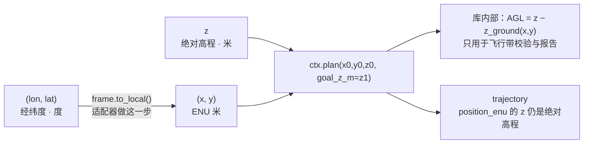

# 后端接入 pp1（path_planning1）

> 读者：后端工程师 / 服务接入方。
> 目标：用最少的代码把 pp1 接进服务——启动一次、规划一条航段、读结果、正确分类失败。
> 版本：v0.4.0 ｜ `ALGORITHM_ID = "pp1-rrt-nlp-time"` ｜ 目标：最短飞行时间，无风。
> v0.4.0 增量：建筑数据新增 `building/*.geojson`（UTF-8、`properties.Height`）入口，
> 与 `*.shp`（GBK 的 DBF）共用同一套口径；一栋都没读到会在启动期报错，不再静默建出空世界。
> **端点高度统一为绝对 z**：入口是 `ctx.plan(start_xy, goal_xy, start_z_m, *, goal_z_m=None)`，
> 真高由库内按 DEM 派生（只用于飞行带校验与结果报告）；旧的 `start_agl_m / goal_agl_m` 已改名，配置键同步为 `start_z_m / goal_z_m`。
> 禁飞区入口新增 `world.nofly_altitude_mode`：外部可写 AGL，`load_nofly` 入口处用 DEM 换算，
> 库内 `NoFlyZone` 仍只存绝对 z；默认 `absolute`（绝对高程，与库内存储口径一致）。
> v0.3.0 增量：静态禁飞区（`nofly.geojson`，当时仅支持绝对高程、可悬浮）接入 SDF 与真几何终检；
> 新增失败码 `endpoint_in_nofly`；禁飞区内容进 `dataset_digest`。默认行为与已有 hash 基线不变。
> 本文只讲**怎么用**；算法设计、实测基线、扩展点见 `path_planning1/README.md`。

> **pp1 是独立库**：不依赖 ta1、也不认识任务/机巢。它只吃「世界目录 + 一条 OD」，负责把这一段
> 飞出真航迹与时长。分配层要串起来时，用 `scene_io.to_pp1_world_kwargs(world)` 把世界目录变成
> `world` 段（纯 dict，不需要 import 任何别的库）。数据组织见 `0数据准备与处理.md`。

---

## 1. 先介绍：这个库是什么

### 1.1 一句话

给一个城市（建筑 + 可选 DEM + 可选静态禁飞区）和一条起终点，返回：

- **一条几何折线**：RRT 在走廊里找到的无碰撞路径；
- **一条带时间的轨迹**：NLP 在走廊内解出的位置 / 速度 / 加速度 + 均匀时间步；
- **指标与诊断**：长度、净空、时长、推力、窗口统计、求解器状态。

它只做“这一条**空中航段**怎么飞”，不负责机巢起降与业务调度。

### 1.2 它不负责什么

| 不负责 | 归谁 |
|---|---|
| HTTP / 路由 / 参数校验以外的 API 语义 | 你的服务 |
| 缓存、队列、超时、取消、重试 | 你的服务 |
| 落库、序列化、前端协议 | 你的服务 |
| 多航段排序、时间窗、容量、任务分配 | 分配层 / 业务层 |
| 机巢起降、地面滑行、垂直爬升/下降段 | 服务层拆段或外部规划 |
| 风场、能耗最优 | 未实现；`energy_j` 恒 `null` |
| 动态禁飞 / 时间窗 | 未实现；单段几秒，由服务层按任务时刻冻结静态集合即可 |

**边界**：`import path_planning1 as pp1` 是唯一对外门面。顶层 `__all__` 里的名字才是交付面；
`path_planning1.core.*` 是内部实现，不要从深路径接服务。`contract` 子包里的
`PlanAlgorithm / PlanRequest / PlanResult / WorldSnapshot` 是早期预留形状，当前不消费，不要按它们写接入代码。

### 1.3 三个核心对象

| 对象 | 生命周期 | 作用 |
|---|---|---|
| `PlanningContext`（`ctx`） | **进程启动时创建一次** | 装载城市、取得全域场、做建场契约自检；跨请求复用 |
| `ctx.plan(...)` | **每条空中航段调用一次** | 做准入，然后规划一条空中航段；是唯一在线入口 |
| `RouteSegmentPlan`（`res`） | 每条空中航段一个 | 结果：状态、失败码、折线、轨迹、指标、诊断 |

`ctx` 在创建时固定一套 `params`；`ctx.plan()` **不接受**新的 `params`。
同一服务要支持多套机型 / 走廊口径，就建多个 `PlanningContext`，不要试图在请求里换参数。

### 1.4 一条请求的流水线

```text
启动一次
  create_context(cfg)
    → load_city（region + buildings + 可选 DEM + 可选 nofly.geojson）
    → build_world_field（或 field_artifact 读产物）
    → check_contract_coverage（覆盖不够就启动失败）

每条请求
  ctx.plan(start_xy, goal_xy, start_z_m, goal_z_m=...)   # z 一律绝对高程
    → 准入：端点出界 / OD 超长 → 直接返回结果码
    → 建走廊窗口
    → 从全域场取样 SDF（或 on_demand 现算）
    → RRT 多初值找候选 → 真几何净空过滤 + 选一条给 NLP（只跑一次 NLP）
    → 真几何净空终检
    → 时间域 NLP
    → RouteSegmentPlan
```

两种建场模式：

| `world.field_mode` | 行为 | 用在哪 |
|---|---|---|
| `startup`（默认） | 启动阶段建一次全域场并自检；在线只按走廊取样 | **生产** |
| `on_demand` | 不建场；每条请求窗口现算 SDF | 低内存 / 冷启动调试；不要用于生产 |

**startup 没有运行期回退**：窗口越界不会被偷偷改成现算，而是抛 `FieldContractError`，按部署事故处理。

### 1.5 先记住四个词

| 词 | 含义 | 对应字段 |
|---|---|---|
| **route / 走廊** | 沿起终点连线展开的三维搜索空间；半宽也是交付轨迹的硬约束 | 不直接返回；见 `stats.corridor_width_m` |
| **path / 折线** | RRT 找到的空间曲线，无时间维；可能超出走廊半宽，只作初值和兜底 | `res.path_enu` |
| **trajectory / 轨迹** | 带时间的交付物；位置 / 速度 / 加速度 + 均匀 `Δt` | `res.trajectory` |
| **z / AGL** | 坐标与接口**只有绝对 z**（`z_basis=absolute_enu_z`）；`AGL = z − z_ground(x,y)` 是库内部按 DEM 派生的量 | 入口收 `z`，输出也是 `z`；AGL 只在飞行带校验和结果报告里出现 |

`z_ground(x,y)` 是**地面高程函数**：返回该水平点的地形高程（m），不是二维点，也不是屋顶高度；
`dem=None` 时按平地取 0。你不需要自己减——传绝对 z 就行，减法是库内一步。

**要飞的是 `trajectory`；`path_enu` 只是几何兜底。** 轨迹存在时，`trajectory.position_enu` 才是最终要执行的那条线。

### 1.6 OD 的语义（重要）

本库的 **OD 是空中航段端点**，不是机巢地面起终点：

- `start_xy` / `goal_xy` 是空中航段的两端；
- `start_z_m` / `goal_z_m` 是这两端的**绝对 z**（与 `x/y` 同一高程基准）；
- 库内部按 DEM 算 `AGL = z − 地面` 判飞行带（默认 `[10, 120]` m），不合规直接 `out_of_flight_band`，不会自动抬高；
- 机巢地面、起降与垂直爬升/下降段不在本库内，由服务层单独拆段或拼接；
- `goal_z_m=None` 表示与起点同高，不是“到地面”。

---

## 2. 教学：从零跑通一条空中航段

### 2.1 安装

在仓库根执行：

```bash
pip install "./path_planning1[nlp]"
python -c "import path_planning1 as pp1; print(pp1.__version__, pp1.ALGORITHM_ID)"
```

- `[nlp]` 是可选依赖 `casadi`；不装也能跑几何层，但通常拿不到 `duration_s`。
- 导入名是 `path_planning1`；pip 发行名是 `uav-path-planning1`。
- **没有 `service` extra**：HTTP / 进程池 / 缓存由你的服务自己装。

### 2.2 准备数据目录

世界目录的完整格式、预检与换城市步骤见 [`0数据准备与处理.md`](0数据准备与处理.md) 第二部分（§7–§13）。这里只记接入侧的两条：

- `world.root` 指到 `data/worlds/<world_id>` 这一层（不是 `data/` 根）。
- `nofly.geojson` 没有 = 没有禁飞区；换文件名 / 位置用 `world.nofly_path`，显式配置但文件不存在会在启动期报错。

### 2.3 配置示例

日常接服务只写这一段：

```json
{
  "world": { "root": "data/worlds/guangzhou" },
  "request": {
    "start_xy": [1636.8, 4198.2],
    "goal_xy": [2040.6, 1393.6],
    "start_z_m": 37.50,
    "goal_z_m": 37.09
  },
  "params": {}
}
```

`params: {}` 等于全默认；`goal_z_m` 不写 = 与起点同高。这两个 z 是该点的**绝对高程**（这处地面约 12.5 / 12.1 m，即离地 25 m）。

> 💡 全量键、全部默认值、`vehicle` 5 项与 `planner` 14 项：
> - 带注释阅读版：[pp1_full_config.example.jsonc](pp1_full_config.example.jsonc)
> - 机器加载版：[pp1_full_config.example.json](pp1_full_config.example.json)
>
> `.jsonc` 是 JSONC，含 `//` 注释；真正 `json.load` 用 `.json`。
> OD 语义见 §1.6：这里传的是**空中航段端点**，不含机巢地面起降。
> 两份里的 `root` / `request` 是样例坐标，换成你的城市与 OD；其余数值为默认值。

三段的分工：

| 段 | 管什么 | 什么时候用 |
|---|---|---|
| `world` | 数据目录、DEM、建场模式、最大 OD 长度 | `create_context` |
| `request` | 这一次飞哪一段、两端绝对 z | `request_from_config` + `ctx.plan` |
| `params` | 机型、走廊、栅格、算法 | `create_context`（请求期不能换） |

`goal_z_m` 不写 = 与起点同高。默认 `v_max=20 m/s`、净空 5 m、
推力 100 N / 5 kg、栅格 4/4/2 m；完整默认值用 `pp1.default_config()` 打出来。

### 2.4 启动上下文（每个进程只做一次）

**开发 / 首次启动**：直接建场。

```python
import json
from pathlib import Path

import path_planning1 as pp1

cfg = json.loads(Path("config.json").read_text(encoding="utf-8"))

# 进程启动时一次；默认 field_mode=startup，会现场建全域场并做覆盖自检
ctx = pp1.create_context(cfg)
```

现场建场约 120–140 s、常驻约 1.15 GB，不要放在每条请求里。

**生产推荐**：构建期先落场产物，服务启动只做 mmap。

```python
# 构建机 / 数据更新后，做一次
build_ctx = pp1.create_context(cfg)
build_ctx.save_field("artifacts/guangzhou/field_maxod3000")

# 服务进程启动
ctx = pp1.create_context(cfg, field_artifact="artifacts/guangzhou/field_maxod3000")
```

产物目录**自己定**（仓库里不带 `artifacts/`，单份约 1.15 GB，按制品库或本地盘另存）；下面只是示例路径。产物包含 `sdf.npy`、`occupancy.npy`、`meta.json`，三个文件必须一起分发；
`meta.json` 是完成标记，不要手改。数据、栅格、走廊、飞行带或 `max_od_length_m` 一变，
就必须重建成产物，否则启动会抛 `FieldContractError`。

启动后建议断言/打点：

```python
print(ctx.field_mode)        # startup / on_demand
print(ctx.field_ready)       # startup 必须 True
print(ctx.field_source)      # built / artifact / none
print(ctx.max_od_length_m)   # 实际生效的契约值，不是配置原始值
print(ctx.field_pad_m)       # 派生外扩，不要手填
print(ctx.dataset_digest)    # 数据内容指纹，缓存键第一段
```

### 2.5 发一条请求：一把尺子

`ctx.plan(start_xy, goal_xy, start_z_m, goal_z_m=None)` 只收两样东西：**ENU 水平米** 和 **绝对 z**。



| 量 | 谁负责 | 说明 |
|---|---|---|
| `(lon, lat) → (x, y)` | **适配器**（`frame.to_local`） | 经纬度是水平坐标的唯一真源；`to_local` 不吃高度 |
| `z` | **调用方原样传** | 与 `x/y` 同一基准；任务包里的 `z_abs`、SQL 里的海拔都直接能用 |
| `AGL` | **库内部** | `z_ground` 从 DEM 采样（无 DEM 取 0），`AGL` 只用于 `[agl_min_m, agl_max_m]` 与结果报告的 `agl_min_m/agl_max_m` |

#### 2.5.1 最小请求

```python
req = pp1.request_from_config(cfg)

res = ctx.plan(
    req["start_xy"],
    req["goal_xy"],
    req["start_z_m"],
    goal_z_m=req["goal_z_m"],   # None = 与起点同高
)
```

#### 2.5.2 水平换算：经纬度 → 局部 ENU 米

```python
x, y = ctx.dataset.frame.to_local(lon, lat)   # → (x, y)，单位米
```

`to_local` **只吃 `(lon, lat)` 两个数，高度不经过它**。它按 `region.geojson` 的 bbox 定原点，
x 向东、y 向北；东向米数按当地纬度缩放（广州 23°N 约 102,398 m/度）。

#### 2.5.3 高度：直接给绝对 z

任务包、点云、三维航迹里给的都是绝对高程，原样传即可。只有在**上游给的是"离地 25 m"这类 AGL**、
且你确实需要换算时才自己加地面（库不做反向换算，因为这属于数据准备）：

```python
import numpy as np

def z_ground(ctx, x: float, y: float) -> float:
    """该水平点的地面高程（m）；没有 DEM 时返回 0。"""
    dem = ctx.dataset.dem
    if dem is None:
        return 0.0
    lon, lat = ctx.dataset.frame.to_lonlat(x, y)
    return float(dem.at_lonlat(np.array([lon]), np.array([lat]))[0])

z0 = z_ground(ctx, x0, y0) + 25.0     # 若上游只给"离地 25 m"
z1 = z_ground(ctx, x1, y1) + 25.0
res = ctx.plan((x0, y0), (x1, y1), z0, goal_z_m=z1)
```

**一个数走到底**：请求 z、结果 `trajectory.position_enu[:, 2]`、`path_enu[:, 2]` 都是绝对高程。
`z` 低于地面 → AGL 为负 → `out_of_flight_band`（报文里会同时给出 `z`、地面、算出来的 AGL），
不会静默抬到地面。

#### 2.5.4 端点语义

这里的端点就是 §1.6 的**空中航段端点**：两端 z 必须使 `AGL` 落在 `[agl_min_m, agl_max_m]` 内；
机巢地面、起降与垂直爬升段不要传给 `ctx.plan`，由服务层拆段。

### 2.6 读结果：先分三种情况

下面 `log` / `fly_path` / `fly_trajectory` 是示例占位，换成你们自己的日志与执行层。

```python
if not res.ok:
    # infeasible：连几何折线都没有；不要读 path_enu
    log.warning("pp1 failed: %s %s", res.failure_code.value, res.message)

elif res.trajectory is None:
    # 几何有解，但 NLP 没解出时间剖面：仍然是 ok，折线可飞，duration_s=None
    fly_path(res.path_enu)

else:
    # 正常：要执行的是轨迹
    fly_trajectory(res.trajectory.position_enu)
```

三个判断的含义：

- `res.ok` = `status == ok` 且 `path_enu` 存在；
- `trajectory is None` **不等于失败**；看 `diagnostics.warnings` / `diagnostics.solver_status`；
- 只有 `status=infeasible` 才是“这条航段不可行”。

### 2.7 结果字段速查

| 字段 | 内容 | 怎么用 |
|---|---|---|
| `res.status` | 实际只有 `ok` / `infeasible` | 业务分支 |
| `res.failure_code` | 9 个实际失败码之一；成功是 `none` | 失败映射（§4） |
| `res.message` | 中文说明 | 日志；不要直接给前端 |
| `res.path_enu` | `(K, 3)` RRT 折线，**绝对 z** | 几何兜底 / 绘图 |
| `res.trajectory` | `t_s`、`position_enu`、`velocity_enu`、`acceleration_enu`、`dt_uniform_s` | 飞控 / 前端；可能为 `None` |
| `res.metrics_dict()` | 扁平 JSON，当前 32 键 | **序列化 / 落库 / 缓存**优先用它 |
| `res.stats` | 窗口与几何统计 | 观测“算了多大地方” |
| `res.diagnostics` | `candidates`、`feasible_candidates`、`warnings`、`solver_status`、`solver_iterations`、`rrt_iterations`、`rrt_nodes` | 日志 / 排障；前两个是多初值，后两个只属于**选中候选** |
| `res.timings` | `window_s` / `grid_s` / `rrt_s` / `clearance_s` / `trajectory_s` / `total_s` | 性能打点；`rrt_s` / `clearance_s` 是 N 条的总耗时，`trajectory_s` 是选中一条的 NLP |
| `res.params_hash` | 12 位口径指纹 | 缓存键；已包含在 `metrics_dict()` 里 |

`res.diagnostics.candidates` 是**实际尝试的初值数**（默认 5），不是最终交付路径数；
`feasible_candidates` 是其中**真几何净空达标**的候选数。两者都可能是 0：
`candidates=5, feasible_candidates=0` 会返回 `path_clearance_violated`，不是 `ok`。

`metrics_dict()` 的字段分三组：

1. 状态：`status`、`failure_code`、`params_hash`；
2. 轨迹指标：`length_m`、`min_clearance_m`、`duration_s`、`max_airspeed_mps`、
   `max_acceleration_mps2`、`energy_j`；
3. 窗口/走廊统计：`horizontal_m`、`corridor_width_m`、`window_shape`、`points`、
   `inside_corridor`、`max_thrust_n`、`agl_min_m` 等。

两个容易误读的字段：

- `length_m` 是 **RRT 折线长度**，不是轨迹弧长；`duration_s` 才是轨迹时长。
- `min_clearance_m` 是 **真几何净空**（建筑棱柱距离），不是 SDF 读数；上限被 30 m 邻域截断，
  报 30 表示“至少 30 m”。
- `stats.ground_start_m / ground_goal_m` 是两个端点的地面高程，`stats.agl_min_m / agl_max_m` 是交付轨迹的真高范围——
  只在报表里对账用，请求/回执的坐标仍然是绝对 z。

---

## 3. 参数：通常只改这几项

### 3.1 `world` 段

| 键 | 默认 | 说明 |
|---|---|---|
| `root` | 必填 | 数据目录；相对路径按进程 cwd，生产建议绝对路径 |
| `with_dem` | `true` | `false` = 平地，地面按 0；数字不能与 DEM 版混比 |
| `height_field` | `"Height"` | 建筑高度字段名：shp 的 DBF 列 / GeoJSON 的 `properties` 键，大小写敏感 |
| `min_area_m2` | `1.0` | 小于此面积的 footprint 碎片丢弃 |
| `terrain_min_z_m` | `0.0` | 地形接楼时的最低 base_z |
| `field_mode` | `"startup"` | 生产用 `startup`；`on_demand` 只用于调试 |
| `max_od_length_m` | `3000` | 同时决定 pad 与请求期 `od_too_long` 上限；调大要重建场 |
| `nofly_path` | `null` | 禁飞区 geojson；`null`/省略 = 数据目录下 `nofly.geojson`（可没有）；显式给了就必须存在 |
| `nofly_altitude_mode` | `"absolute"` | `absolute` 读 `z_min_m/z_max_m`；`agl` 必须有 DEM（`with_dem=true`），读 `agl_min_m/agl_max_m` 并由 DEM 换算；内部只存绝对 z |

### 3.2 `params` 段：只碰这些

| 键 | 默认 | 什么时候改 | 注意 |
|---|---|---|---|
| `roi.width_ratio` | `0.2` | 走廊太窄导致无解时适当放大 | 走廊总宽 = ratio × 水平距离；调大也会放大 pad |
| `roi.half_width_m` | `null` | 想直接指定半宽（米） | 优先于 ratio；这是**轨迹硬约束**，不是栅格 margin |
| `roi.margin_m` | `50` | 起终点贴边被切时 | 只垫栅格，不放宽交付边界 |
| `spacing_m` | `[4, 4, 2]` | 确实需要改分辨率时 | **一次改三样**：耗时/内存、膨胀量、SDF 容差；必须重跑基线 |
| `agl_min_m` / `agl_max_m` | `10 / 120` | 业务飞行带变化 | 端点 z 派生的真高按此带校验；改窄后原本合法的请求会被 0 秒拒绝 |
| `seed` | `0` | 需要不同随机种子时 | 同参同 seed 才可复现 |
| `vehicle.v_max_mps` | `20` | 机型巡航速度 | 不是标称极速；实际轨迹会受加速度/推力约束 |
| `vehicle.a_max_mps2` | `3` | 机型可用加速度 | 转弯半径约 `v²/a`，要装得进走廊 |
| `vehicle.clearance_m` | `5` | 运行许可要求 | 政策参数；调大可能直接无解 |
| `vehicle.thrust_max_n` | `100` | 机型推力上限 | 悬停需 `T ≥ m·g`，否则启动/请求 0 秒 `ValueError` |
| `vehicle.mass_kg` | `5` | 起飞质量 | 含电池/载荷；与推力一起校验 |

`params.planner` 有 14 项，默认即可。通常只动 4 个：

- `n_resample`（60）：节点数；更长 OD 可试 80；
- `rrt_max_iters`（3000）：确信有路却 `rrt_no_path` 时才抬；
- `rrt_shortcut_iters`（200）：想让折线更直；
- `ipopt_max_iter`（200）：先留 200；真撞迭代上限再抬。

`rrt_initializations`（默认 5，范围 1–20）：按 `seed+i` 跑 N 次 RRT，真几何过滤后选一条给 NLP。
难走廊可加到 8–10，代价是 RRT 段近似线性变长；不是“跑得越多一定越好”。

其余 9 项与净空闸/基线共用，**不要随手改**。

### 3.3 默认值与配置校验

```python
print(pp1.default_config())                 # 全量模板
print(pp1.params_to_config(ctx.params))     # 当前在用的参数摊平
```

规则：

- 不写 = 默认；整段省略 = 全默认；写 `null` 和省略不是一回事；
- 未知键直接 `ValueError`，不会静默忽略；
- 零宽走廊、`spacing<=0`、真高上下限反序、`dt_max<=dt_min` 等会在启动/解析期拒绝。

---

## 4. 结果与失败码

### 4.1 失败是结果，不是异常

`status` 实际只出现 `ok` / `infeasible`；`Status` 枚举里另有 `timeout` / `invalid_input` /
`internal_error`，**本包不返回**，不要为它们写分支。

实际会返回 9 个 `failure_code`：

| `failure_code` | 什么情况 | 调用方动作 |
|---|---|---|
| `none` | 成功 | 正常消费 |
| `outside_world` | 端点超出城市 `bounds_m`（`ctx.plan()` 准入） | 改点；城市外没有数据 |
| `od_too_long` | OD 超过 `max_od_length_m`（`ctx.plan()` 准入） | 拆航段，或调大契约并重建场 |
| `out_of_flight_band` | 端点 z 换算出的 AGL 不在带内；OD 是空中航段端点；高地可能受 z 包络二次限制 | 改 z / 改点 |
| `start_or_goal_blocked` | 起终点 SDF 净空不足（落在楼里/贴墙） | 改点；不要靠调 RRT 救 |
| `endpoint_in_nofly` | 端点落在静态禁飞区内（绝对高程口径，含边界） | 改端点；库不会静默抬升或平移 |
| `rrt_no_path` | 走廊带内几何无解 | 先查走廊宽度、分辨率、数据；别先调 RRT 参数 |
| `roi_no_path` | 折线出了半宽，且 NLP 在半宽约束下解不出轨迹 | 放大 `ratio/half_width` 或改点 |
| `path_clearance_violated` | 真几何终检仍不满足净空（求解器缺陷） | 记录 OD/hash/最差点；不要重试掩盖 |

`outside_world` / `od_too_long` 只在 `ctx.plan()` 返回；直接调内部纯函数没有这两条准入。
`NLP_INFEASIBLE / NLP_MAX_ITER / SOLVER_UNAVAILABLE / TIME_BUDGET_EXCEEDED` **不会返回**；
NLP 失败是降级：`status=ok`、`trajectory=None`、`warnings` 说明原因。

**HTTP 映射（建议，最终按贵司网关规范）**：`outside_world / od_too_long / out_of_flight_band /
start_or_goal_blocked / endpoint_in_nofly` 按 4xx；`rrt_no_path / roi_no_path` 是“业务不可行”，
用 200 + `ok=false` 或 422 均可；`path_clearance_violated` 按 5xx 告警；`FieldContractError`
按 503 / 不就绪，不要重试。

### 4.2 异常怎么分类

| 异常 | 发生阶段 | 含义 | 处理 |
|---|---|---|---|
| `ValueError` | `create_context` / `ctx.plan()` | 配置错、坐标 NaN、间距非正、机型悬停都不够 | 启动期按启动失败；请求期按 4xx 调用方错误 |
| `FieldContractError` | 启动或请求期 | 产物过期/损坏、契约漂移、窗口越界 | **部署事故**：告警、不就绪、重建产物/重部署；不要映射成 400，不要重试 |
| `FileNotFoundError` | 启动期 | 数据目录缺 `region.geojson` / `building` / `dem.tif`，或显式配的 `nofly_path` 找不到 | 数据问题；修数据后重启 |
| 产物解析异常（`JSONDecodeError` / `KeyError` 等） | 启动期 | 产物文件被截断/手改 | 与 `FieldContractError` 同类：不接流量，重建产物 |

`FieldContractError` 继承 `RuntimeError`，不是 `ValueError`；窗口越界子类是 `WindowOutsideField`。

### 4.3 缓存键

```text
cache_key = ctx.dataset_digest
          + start_xy + goal_xy
          + start_z_m + goal_z_m
          + res.params_hash
```

- `ctx.dataset_digest`：建筑/DEM/禁飞区内容指纹，12 位；**存在禁飞区文件（或显式配置
  `nofly_path`）时**，文件或非默认 `nofly_altitude_mode` 一改就变，产物同时失效（默认 `absolute` 不额外写 mode，因为它是默认值，指纹里无需冗余记录）；
- `res.params_hash`：参数 + 场身份 + 取样补偿量的口径指纹；startup 与 on_demand 不同；
- 端点坐标与两端绝对 z 不在 `params_hash` 里，必须自己拼进去；
- 不要自己猜 `world_id`，直接用 `ctx.dataset_digest`。

---

## 5. 部署：并发、产物、容量

### 5.1 进程模型

- **每个进程只创建一个 `ctx`**，跨请求复用；不要每条请求 `create_context`。
- **用进程池，不要线程池**：scipy EDT / IPOPT 是单核密集，GIL 不解。
- `ctx.field` 只读，可跨请求共享；不要 pickle 进队列。
- 本包**没有超时 / 取消**。硬超时在进程池里 kill 子进程；求解侧唯一上界是 `ipopt_max_iter`。

### 5.2 场产物

生产推荐“构建期建场、服务期 mmap”：

```text
构建机：create_context(cfg) → ctx.save_field("artifacts/<world_id>/field_maxod<N>")
服务机：create_context(cfg, field_artifact="artifacts/<world_id>/field_maxod<N>")
```

- 产物是 `sdf.npy + occupancy.npy + meta.json` 三个文件；
- 加载时校验 schema / 场身份签名 / `dataset_digest` / 建场契约；`dataset_digest` 已含禁飞区，
  所以禁飞区 geojson 改了但没重建产物，启动即失败（场里已经把它栅格化过）；
- 数据或建场契约一变，产物启动即失败，这是正确行为（不是 bug）；
- 多进程从同一份产物 mmap，可共享物理内存。

### 5.3 容量量级（广州样例，4/4/2，默认 `max_od=3000`）

| 阶段 | 时间 | 内存 |
|---|---|---|
| 世界加载（`create_context` 启动时一次） | ≈2.5 s | 92 MB |
| 现场建全域场 | 120–140 s | 常驻 ≈1.15 GB；峰值约 4.1 GB（推算） |
| 读场产物启动 | ≈0.03 s | 同样 ≈1.15 GB，mmap 共享 |
| 2.8 km 航段（有场） | ≈8 s（默认 5 初值、`v_max=20`；把 `v_max_mps` 改成 15 约 4.2 s） | 场 + 约 60 MB |
| 2.8 km 航段（`on_demand`） | 5–7 s | 约 475 MB |

这些是广州样例，不是通用值；换城市/换格距后按目标数据重算，不要照抄。

### 5.4 上线前最短自检

1. `import path_planning1 as pp1`，确认版本；
2. `create_context(cfg, field_artifact=...)` 能过，`ctx.field_ready is True`；
3. `ctx.field_source == "artifact"`，`ctx.dataset_digest` 与制品记录一致；
4. 用一条已知 OD 调 `ctx.plan()`，`res.ok is True`，`duration_s` 有值；
5. 把端点 z 调到地面以上 130 m 调一次，确认返回 `out_of_flight_band`（报文会写出 z、地面与算出的 AGL）；
6. 若产物损坏/数据改动，确认启动期失败而不是带病接流量。

---

## 6. 注意事项

1. **startup 没有运行期回退**。窗口越界就是 `FieldContractError`，不要写“场不够就现算”的兜底。
2. **`ctx.plan` 的参数在启动时固定**。不同机型/走廊/栅格要建多个 `ctx`；场产物只在
   `spacing / ROI / 飞行带 / max_od / bounds / 数据` 相同时可复用。
3. **`max_od_length_m` 默认 3000 m**。5.6 km 的城市对角 OD 在 startup 下会 `od_too_long`；
   要么拆航段，要么调大契约并接受更大的场与内存。`ctx.max_od_length_m` 是实际生效值。
4. **`trajectory=None` 不是失败**。几何可飞、NLP 没解出来时仍然 `ok`，`duration_s=None`；
   看 `diagnostics.warnings` / `solver_status`。不要把它映射成 500。
5. **`path_enu` 可能超出走廊半宽**，它是 RRT 初值/兜底；交付是否在走廊内看
   `stats.inside_corridor`（有轨迹时按轨迹量）。
6. **`duration_s` 是最短飞行时间解**，不是“距离 / v_max”；两端速度为 0。`energy_j` 恒 `null`，
   没有风场，不要拿能耗比较方案。
7. **净空以真几何为准**。`min_clearance_m` 由 shapely 量建筑 + 禁飞区棱柱，不是 SDF；
   上限 30 m（邻域查询半径），报 30 表示“至少 30 m”。
8. **`spacing_m` 不是普通精度旋钮**。它同时改变耗时/内存、建筑膨胀量、SDF 容差和全部基线；
   改完必须重跑覆盖与回归，不同口径的缓存不要混用。
9. **数据必须是 EPSG:4326 经纬度**。建筑可用 `building/*.shp`（DBF 为 GBK）或
   `building/*.geojson`（UTF-8，高度在 `properties.Height`），高度字段默认 `Height`、须为有限正数；
   DEM 可选，`with_dem=false` 时按平地 0。投影米坐标要先在入库前转成经纬度。
10. **`on_demand` 只用于调试**。它不建场、不做 `od_too_long` 准入、每条请求都现算；
    生产默认 `startup`。`field_artifact` 只能在 startup 下使用。
11. **产物三件套一起分发**。只拷 `sdf.npy`、手改 `meta.json`、或让产物与数据版本不一致，
    都会在启动期失败；这是身份校验，不是 bug。
12. **本包不做 HTTP / 缓存 / 队列 / 超时 / 序列化**。这些都在你的服务里；库只提供
    `ctx`、`ctx.plan`、结果对象、`params_hash` 和数据指纹。
13. **不要从 `core` 深路径接服务**。顶层 `__all__` 才是交付面；内部函数随重构变化，
    今天能 import 不代表明天还是契约。唯一例外：只读数据集预检（不建场）只能
    `from path_planning1.core.city_dataset import load_city`，见 `0数据准备与处理.md` §12。
14. **城市尺度 < 25 km**。`LocalFrame` 是局地切平面近似，没有 UTM 转换；更大范围要先重投影，
    或给 frame 接 UTM 后端。
15. **禁飞区输入可选 AGL，但库内只存绝对 z**。`world.nofly_altitude_mode='agl'` 时数据写
    `agl_min_m/agl_max_m`，`load_nofly` 用 DEM 换算；`NoFlyZone`、SDF、场、终检统一用绝对 z。
    禁飞区仍是静态、可悬浮；时间窗禁飞不在库内，服务层按任务时刻冻结一份静态集合传入。

### 6.1 换城市

数据准备、字段要求、预检与投影转换统一见 [`0数据准备与处理.md`](0数据准备与处理.md) 第二部分。

换城市只换 `world.root` 指向的目录，重新建场；`frame` 由新区 bbox 自动生成，调用方不要自己造。

### 6.2 常见坑

- **经纬度当 ENU 传**：`start_xy` 必须是米；经纬度先 `frame.to_local`。
- **高度只传绝对 z**：接口不认 AGL。你手里的数若是"离地 25 m"，先 `z = z_ground(x,y) + 25`
  （`z_ground` 是地面高程函数，不是二维点；无 DEM 时为 0），别把 25 直接当 z。
  反过来，禁飞区数据若写 `z_min_m / z_max_m`，它们就是**绝对高程**；想直接写 AGL，请用
  `agl_min_m / agl_max_m` 并把 `world.nofly_altitude_mode` 设为 `"agl"`，不要两种字段混写。
- **起终点重合**：水平距离 < 1e-6 m 会 `ValueError`；原地起飞不是一条航段。
- **NaN 坐标 / 零间距**：`ValueError`，不是失败码；这是调用方编程错误。
- **把 `path_enu` 当交付轨迹**：它可能超出半宽；有 `trajectory` 时用它。
- **拿两套口径的数字对比**：startup 场版与 on_demand 现算版的 SDF 离散化不同，
  长度/净空/迭代会有差异；只比较同一口径。
- **手填 `field_pad_m`**：pad 是 `max_od` / ROI / 格距派生的，不是配置项。

---

## 7. 一页速查

### 7.1 顶层 API

```python
pp1.create_context(cfg, *, field_artifact=None, field_mode=None, max_od_length_m=None)
pp1.request_from_config(cfg)
pp1.params_from_config(cfg)
pp1.default_config()
pp1.params_to_config(params)

ctx.plan(start_xy, goal_xy, start_z_m, *, goal_z_m=None)
ctx.save_field(path)
```

> 高级传法：`create_context(world_kwargs=..., params=pp1.params_from_config(cfg))` 可绕开 `cfg` 直接给对象；
> 普通接入不需要。

### 7.2 默认口径

```text
真高 10–120 m ｜ 净空 5 m ｜ 栅格 4/4/2 m
走廊总宽 = 0.2 × 水平距离；margin 50 m
v_max 20 m/s ｜ a_max 3 m/s² ｜ 推力 100 N ｜ 质量 5 kg
max_od_length_m 3000 m ｜ field_mode startup
```

### 7.3 结果三句话

```text
1. res.ok 为 False：这条航段不可行，不要读 path_enu。
2. res.ok 为 True 且 trajectory 为 None：折线可飞，没有时间剖面。
3. res.ok 为 True 且 trajectory 非 None：执行 trajectory.position_enu。
```

### 7.4 失败码

```text
none                    # 成功；没有失败
outside_world           # 端点超出城市 bounds_m；仅 ctx.plan() 准入
od_too_long             # OD 超过 max_od_length_m；仅 ctx.plan() 准入
out_of_flight_band      # 端点 z 换算出的 AGL 不在 agl_min_m–agl_max_m 内；OD 是空中航段端点
start_or_goal_blocked   # 起终点 SDF 净空不足（落在楼里/贴墙）
endpoint_in_nofly       # 端点落在静态禁飞区内（绝对高程口径）
rrt_no_path             # 走廊带内几何无解
roi_no_path             # 折线出了半宽，且 NLP 在半宽约束下解不出可交付轨迹
path_clearance_violated # 真几何净空终检仍不满足（求解器缺陷）
```

---

本文只讲 pp1 自身；与 ta1 的对接、联合验收与延迟预算见 [`3任务分配-路径规划对接.md`](3任务分配-路径规划对接.md)。
