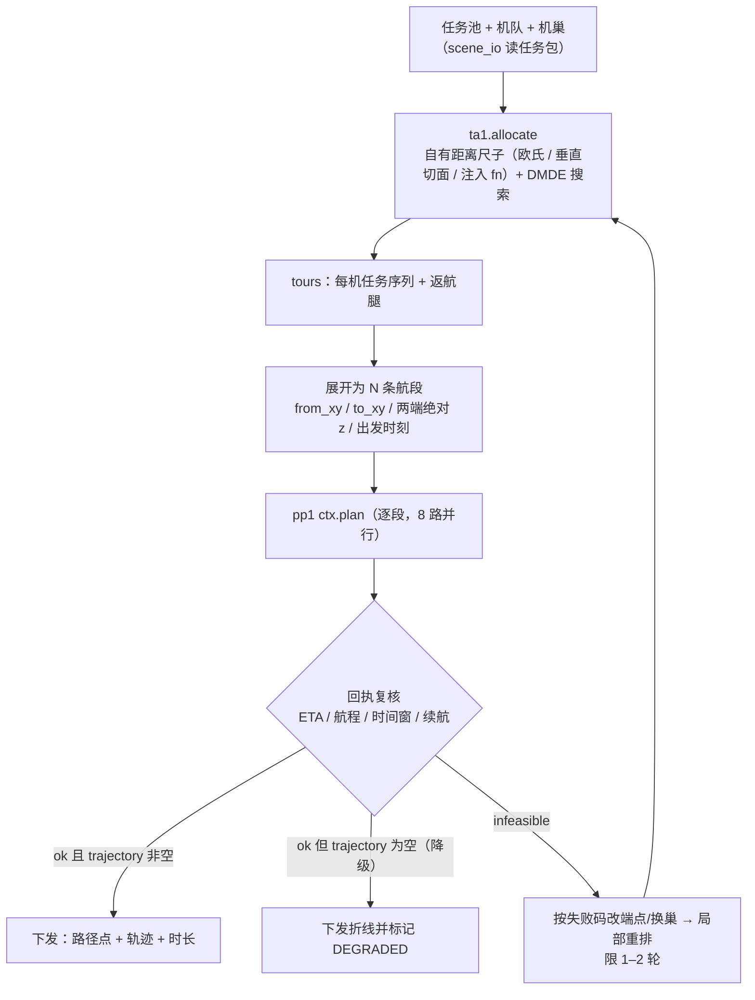

# 3. 任务分配 ↔ 路径规划：怎么对接

**ta1 决定"谁飞、按什么顺序飞、回哪个巢"；pp1 决定"这一段具体怎么飞"。**
两者不 import 对方，只通过一件事对接：**一条航段的请求 → 回执**。

> 数据怎么准备见 [`0数据准备与处理.md`](0数据准备与处理.md)；ta1 / pp1 各自怎么用见
> [`1怎么用-ta1算法.md`](1怎么用-ta1算法.md) / [`2怎么用-pp1算法.md`](2怎么用-pp1算法.md)。本文只讲对接。

---

## 1. 两个库的关系

| 项 | ta1（任务分配） | pp1（路径规划） |
|---|---|---|
| 回答的问题 | 谁飞 / 什么顺序 / 回哪个巢 / 什么时候 | 这一条航段怎么飞（轨迹 + 时长 + 净空） |
| 输入 | `Task / UAV / Nest` 内存对象（读文件由 `scene_io` 负责） | 一个世界目录 + 一对端点 |
| 输出 | `result.solution.tours`（每机一条任务序列）+ `metrics_dict()` | `path_enu` / `trajectory` / `duration_s` / 指标 |
| 花多少时间 | 毫秒级（搜索期问的是"米数"） | 秒级（**只有定稿后才跑**） |
| 知道对方吗 | 不知道 pp1 存在，只认自己的距离尺子（`cost_config`，或注入的 `distance_fn`） | 不知道巢、不知道任务，只认端点 |

三句话概括：

1. **不共享代码，只共享数据基准**：同一个 `frame`（`region.geojson` 决定）、同一个 `world.json`、同一套**绝对 z**。ta1 不 import pp1，pp1 不 import ta1，中间的翻译交给适配器（`scene_io` 或你们自己的）。
2. **原子接口是单航段**，不是整条 tour。理由：缓存按 OD 命中、失败可局部重试、并行天然。
3. **方向是单向的**：ta1 的答案 → 展开成航段 → pp1 逐段落地 → 回执拿去复核 → 违约才局部重排。pp1 永远不反过来影响分配搜索。



---

## 2. 对接就三步

### 2.1 第一步：ta1 出 `tours`

```python
import task_allocation1 as ta1

# 档位一：默认三维欧氏（无地形/要最省事）
req = ta1.AllocateRequest(tasks=tasks, uavs=uavs, nests=nests)
# 档位二：ta1 自带的垂直切面代理（飞行带/净空/爬升率是 ta1 的配置）
cost = ta1.CostConfig(model="vertical_section", agl_min_m=10, agl_max_m=120,
                      clearance_m=5, climb_rate=0.15)
req = ta1.AllocateRequest(tasks=tasks, uavs=uavs, nests=nests, cost_config=cost,
                          ground_z=ground_fn, obstacle_top_z=envelope_fn)
# 档位三：完全自己接管（有 pp1、想按执行口径算）
req = ta1.AllocateRequest(tasks=tasks, uavs=uavs, nests=nests, distance_fn=my_distance_fn)

result = ta1.allocate(req)

for tour in result.solution.tours:                      # UAVTour
    print(tour.uav_id, tour.task_ids, tour.end_nest_id)  # 同巢口径：end_nest_id == 起飞巢
print(result.home_return_ok)                            # 同巢不变量自检
```

- **耦合点只有一个：距离尺子**——`distance_fn(pa, pb) -> 米`（有向）。不传时按 `cost_config` 装配；两者同时给 `distance_fn` 优先。
- 档位二/三的差别是"谁的代理"：`cost_config` 是 ta1 自己的估算器（沿连线竖直切面跟随，秒级以内）；`distance_fn` 可以是拿 pp1 真航迹算的米数（每腿秒级）。两者不是同一个数，也不需要相等。
- 有世界数据时，档位二的两个采样器不用自己写：`scene_io.to_ta1_cost_samplers(world)` 直接返回 `ground_z` / `obstacle_top_z`。
- **返航腿必须展开**：同巢口径下每条 tour 的末段固定是"末任务 → 起飞巢"，不能只算任务之间的边。
- 分配层输出的米数/时长只用于**排序**，不是交付值。

### 2.2 第二步：把每条航段交给 pp1

```python
import path_planning1 as pp1

cfg = {"world": scene_io.to_pp1_world_kwargs(world), "params": {}}   # world 段来自世界目录
ctx = pp1.create_context(cfg)          # 进程启动时一次（生产用 field_artifact=）
segments = expand_tours(result)        # 你的适配器：tour → 航段列表

for seg in segments:                   # 实际用进程池，8 路左右
    res = ctx.plan(seg.start_xy, seg.goal_xy, seg.start_z_m, goal_z_m=seg.goal_z_m)
```

- `start_xy / goal_xy` 是 ENU 米，来自 `frame.to_local(lon, lat)`；
- `start_z_m / goal_z_m` 是**绝对 z**，直接用（任务包里的 `z_abs` 就是这个口径）；业务上要求"离地 25 m 巡航"时，在展开这一步算成绝对 z 即可，交给 pp1 之后没有再换算的环节；
- 端点必须是**空中航段端点**：机巢地面、起降与垂直爬升/下降段自己拆，不要塞给 `ctx.plan`。

### 2.3 第三步：回执复核，闭环

三种结果，处理方式完全不同：

| 回执 | 含义 | 你该做什么 |
|---|---|---|
| `status="ok"` 且 `trajectory` 非空 | 有可执行轨迹 | 用 `duration_s` 重判 ETA、时间窗、续航；下发 |
| `status="ok"` 但 `trajectory is None` | 几何可飞，时间剖面没解出来（NLP 降级） | 标 `DEGRADED`，只能给折线；**不要当成已验证时间可行性** |
| `status="infeasible"` | 这一段无解 | 按 `failure_code` 改端点 / 换巢 → 局部重排（§4） |

复核必做的三项：

- `ETA = 出发时刻 + duration_s + 地面服务时间`（服务时间是分配层的语义，pp1 不含）；
- `航程 += length_m`，`续航/最大时间` 用真值重判；
- 任何一项违约 → **只做局部重排**（换序 / 换机 / 拆任务），不要回到全局重解（600 s 周期吃不下第二次搜索）。

---

## 3. 请求与回执（字段级）

### 3.1 请求（适配器 → pp1）

```json
{
  "frame_id": "gz-v1",
  "from": {"x": 1636.8, "y": 4198.2, "z": 37.50},
  "to":   {"x": 2040.6, "y": 1393.6, "z": 37.09},
  "params": {"agl_min_m": 10.0, "agl_max_m": 120.0,
             "roi": {"width_ratio": 0.2, "margin_m": 50.0},
             "spacing_m": [4, 4, 2],
             "vehicle": {"clearance_m": 5.0}},
  "objective": "time",
  "seed": 0,
  "want_trajectory": true
}
```

落到 pp1 的调用：`ctx.plan((x0, y0), (x1, y1), z0, goal_z_m=z1)`；`params` 就是配置文件的 `params` 段，建 `ctx` 时一次固定（请求期不能换机型 / 走廊 / 栅格）。

### 3.2 回执（pp1 真实输出，广州 2.86 km 样例）

```json
{
  "status": "ok",
  "failure_code": "none",
  "metrics": {"length_m": 2859.7, "duration_s": 149.236, "min_clearance_m": 6.92,
              "max_airspeed_mps": 19.996, "agl_min_m": 23.6, "agl_max_m": 86.7,
              "energy_j": null},
  "path_enu": [[1636.8, 4198.2, 37.5], ["..."], [2040.6, 1393.6, 37.09]],
  "trajectory": {"t_s": [0.0, 2.529, "..."], "position_enu": ["(N,3)"], "dt_uniform_s": 2.529},
  "params_hash": "fb7b2c24ca34",
  "world": {"dataset_digest": "d60b50223a62", "field_mode": "on_demand"}
}
```

`dataset_digest` 在 `ctx` 上（`ctx.dataset_digest`），不在 `res` 里；适配器拼缓存键时自己带上。

复现这段数（`on_demand` 现算口径）：

```python
import json, pathlib, path_planning1 as pp1
cfg = json.loads(pathlib.Path("docs/pp1_full_config.example.json").read_text(encoding="utf-8"))
cfg["world"]["field_mode"] = "on_demand"
ctx = pp1.create_context(cfg)
res = ctx.plan((1636.8, 4198.2), (2040.6, 1393.6), 37.50, goal_z_m=37.09)
print(res.metrics_dict(), res.params_hash, res.timings)
```

### 3.3 五条字段约定

1. **单位一律带后缀**：`_m / _s / _mps / _j`，不出现无后缀数值。
2. **`z` 只有一种**：请求端点、`path_enu`、`trajectory.position_enu` 的 z 都是绝对高程；`metrics` 里的 `agl_min_m/agl_max_m` 是库内部按 DEM 算出来顺便报的，不用来回换。
3. **`duration_s` 只能由 pp1 给**，分配层不得用 `length/speed` 重算——那就是历史上"两套长度"缺陷的翻版。
4. **`min_clearance_m` 是真几何**（建筑棱柱 3D 距离，采样 1 m），不是 SDF 读数：名义 5 m，实测往往 6–9 m，别当精确值用。
5. **`energy_j` 恒为 `null`**，别做依赖。

### 3.4 缓存键

```text
cache_key = ctx.dataset_digest + params_hash + 两端 xy + 两端 z
```

- `ctx.dataset_digest`（广州 `d60b50223a62`）：建筑 / DEM / 禁飞区内容指纹，数据一改立即失效；
- `params_hash`（现算 `fb7b2c24ca34` / 场版 `d4ecf1210e78`）：算法 + 机型 + 走廊 + 栅格 + seed 的口径指纹，**两种场模式不同，别混用**；
- 端点坐标与两端 z 不在 `params_hash` 里，必须自己拼。

---

## 4. 失败码与降级（9 个，都是真实返回值）

先看 `status`（只有 `ok` / `infeasible`），`infeasible` 时按 `failure_code` 选动作：

| `failure_code` | 含义 | 降级动作（代价从低到高） |
|---|---|---|
| `none` | 成功（`trajectory` 可能为空 → 降级，见上表） | — |
| `outside_world` | 端点出城市 bounds（仅 `ctx.plan` 准入） | 改点；城市外没有数据 |
| `od_too_long` | OD 超 `max_od_length_m`（仅 `ctx.plan` 准入） | 拆航段，或调大契约并重建场 |
| `out_of_flight_band` | 端点 z 换算出的真高不在 10–120 m（含 z 低于地面） | 改端点 z（够 10 m 即可，不必整段抬） |
| `start_or_goal_blocked` | 端点落楼里或贴墙（净空不足） | 挪到最近自由点，别放宽净空硬凑 |
| `endpoint_in_nofly` | 端点落静态禁飞区（绝对 z 口径，含边界） | 改端点；库不会静默抬升或平移 |
| `rrt_no_path` | 走廊内几何无解 | ① `roi.ratio` 0.2→0.3；② 抬 `agl_max`；③ 放宽 `clearance`；④ 换终点巢 |
| `roi_no_path` | 折线出半宽、半宽内也解不出可交付轨迹 | 同 `rrt_no_path`，优先 `ratio / half_width` |
| `path_clearance_violated` | 抬净空重解仍不达标（求解器缺陷） | 不重试；报 OD + `params_hash` + 最差点，人工介入 |

三条纪律：

- `ok + trajectory=None` 是**降级**，不是失败——`solver_unavailable / time_budget_exceeded / nlp_infeasible / nlp_max_iter` 四个预留码本包不返回，别为它们写重试。
- `ValueError` 只代表调用方 bug（NaN 坐标、`spacing≤0`、机型不自洽），别映射成 400。
- 服务层要的 `DEGRADED / TIMEOUT / REJECTED_*` 是**适配器的状态**，由 `ok + trajectory==null` 显式派生。

---

## 5. 延迟预算（决定并行几路）

单段（2.86 km，场就绪、20 m/s）：

| 项 | 值 |
|---|---|
| 单航段 L3 合计 | **5.7–8.2 s**（本机 7.3–7.5 s；`on_demand` 5.5–5.6 s；`v_max=15` 约 4.3 s） |
| 其中 SDF 取样 / RRT / 净空 / NLP | 0.5–0.9 / 1.3–1.9 / 0.05–0.1 / 4.7–5.0 s |
| 进程启动一次的开销 | 加载世界 2.5 s；建全域场 120–140 s（常驻 1.15 GB，或用 `field_artifact` mmap 0.03 s） |
| 同 OD 二次（有缓存） | ≈ 0 s |

一个周期（5 机 × 4 任务 = 25 条定稿航段）：

| 策略 | 墙钟 | 说明 |
|---|---|---|
| 串行 L3 | **150–200 s** | 吃掉 600 s 周期的 25–34%，只剩 1 轮重试余量 |
| 8 路并行 | **20–26 s** | 必须上进程池（IPOPT / scipy 单核密集，GIL 不解） |
| 命中缓存 | 1–3 s | 下周期同 OD 复用 |

原则：**搜索期只用代理（毫秒），落地才跑真路径（秒），落地结果进缓存**。

---

## 6. 验收清单

1. **frame 对齐**：同一经纬度两侧 frame 差 ≤0.5 m，或记录固定的系统差并在适配器里一次性折算。
2. **排序一致性**（主指标）：10–20 条真实航段，代理排序 vs L3 排序比 Kendall τ 与 top-k 重合度，门槛 τ ≥ 0.9、top-k ≥ 90%（**尚未实测**）。
3. **硬门留余量**：代理与真值有系统偏差（广州实测：欧氏中位 −0.4%、切面 10–120 中位 +0.8%，单腿最大 ±4%），`remaining_range / max_time / 时间窗` 在分配层按 ×0.95 收紧，落地后按真值放行。
4. **可行性回归**：`params_hash` 现算 `fb7b2c24ca34`，0-1 段 2859.7 m / 149.236 s / 净空 6.92 m（时间窗 23.6–86.7 m AGL）——换机器、改 `spacing`、改机型都要重测。
5. **失败码各一条构造用例**：`rrt_no_path`、`out_of_flight_band`、`roi_no_path`、`outside_world`、`od_too_long`，确认降级动作真的改了结果，而不是只改文案；后两条只走 `ctx.plan()`。

---

## 7. 最容易踩的六个坑

1. **拿代理米数去交付**。ta1 的米数只用于排序，交付一律用 pp1 的 `length_m / duration_s`。
2. **把两把尺子混成一个**。ta1 的 `cost_config` 是它**自己的**代理尺子（默认欧氏，或垂直切面：飞行带、净空、爬升率都是 ta1 的参数，秒级以内）；pp1 的飞行带/净空是**执行口径**，写在 pp1 配置里。二者允许不一致，判据是"代理偏差本身"，不必逐位对齐——但 ta1 的米数不能当 pp1 的交付值。
3. **用 `length/speed` 当 ETA**。L2/L3 之后必须用 `duration_s`，否则短航段的爬升会被低估。
4. **端点给的是机巢地面**。`ctx.plan` 只收空中航段端点；0 m 附近会被 `out_of_flight_band` 直接拒。
5. **把 `ok` 当"已验证"**。`trajectory=None` 时只有几何，没有时间可行性。
6. **缓存键漏 `dataset_digest`**。数据一改，旧路径就失效；只拼 `params_hash` 会发出穿楼的航迹。

---

## 8. 还悬着的三件事

| # | 问题 | 建议 |
|---|---|---|
| 1 | 能耗放哪：进分配目标，还是只做落地度量 | 都不进；pp1 当前不产能耗（`energy_j=null`），等接风场再谈 |
| 2 | 走廊 `ratio` 固定 0.2 还是按 OD 长度分档 | 先固定 0.2，>3 km 再降到 0.15 省算力 |
| 3 | 接口粒度要不要 tour 级 | 保持单航段；tour 级牺牲缓存与局部重试，暂无收益 |
