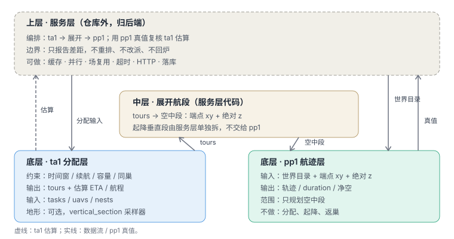

# 4. 完整流程 Tutorial：从 0 到一次可交付的多机协同任务

> **背景**：拉萨市城关区（`lasa_chengguan`）。
> **约定**：本文用 `/` 表示项目根目录（`06project-for-uav/`），所有相对路径从它算起。
> **目标**：安装 → 配置 → 校验 → `ta1` 分配 → 展开航段 → `pp1` 逐段规划 → 回执复核（只报告差距）→ 落盘。
> **可执行**：每步都能直接复制运行；配套脚本是 [`docs/examples/run_lasa_demo.py`](examples/run_lasa_demo.py)，数据已随仓库提供。
> 数据格式与换城市不在本文展开，统一见 [`0数据准备与处理.md`](0数据准备与处理.md)。

## 1. 项目结构：每个包、每个目录是干什么的

### 1.1 三个包

```text
/
├─ task_allocation1/     【ta1】分配层：谁飞、什么顺序、回哪个巢
├─ path_planning1/       【pp1】落地层：这一条航段到底怎么飞（航迹 + 时长 + 净空）
└─ scene_io/             数据适配层：世界 / 任务包 → 纯数据（零依赖）
```

| 包 | 回答什么 | 依赖 | 一句话 |
|---|---|---|---|
| `task_allocation1` (ta1) | **谁飞 / 什么顺序 / 回哪个巢** | `numpy` + `pillow` + `pyshp`（随包安装） | 纯计算；有地形读世界，没地形自动欧氏；同巢起降（终点恒=起飞巢） |
| `path_planning1` (pp1) | **这一条航段怎么飞** | `numpy scipy pillow shapely pyshp`（+ 可选 `casadi`） | 读世界目录；RRT + CasADi/IPOPT，目标是**最短飞行时间** |
| `scene_io` | **数据怎么落到磁盘、怎么读进来** | **无**（纯标准库） | 不 import ta1/pp1；对接靠数据契约 + 懒加载桥 |

**三件事先记住**（后面所有内容都建立在这三条上）：

1. **两库互不 import，各自可单独安装上线**。只用分配就只装 ta1，只用规划就只装 pp1。
2. **对接只走数据契约**：同一套 ENU 米、同一个 `frame_hash`、同一份 `world.json`。
3. **高度从头到尾只有一个口径：绝对 `z`**。`AGL`（真高）是 pp1 库内部按 DEM 派生的校验量，
   **不是接口字段、也不落库**。拉萨地面 ~3650 m，"离地 40 m" 就是 `z_abs ≈ 3690`，**不要传 40**。

### 1.2 目录树（数据 / 产物 / 结果）

```text
/
├─ data/                                 # 进版本库（建筑 shp 除外）
│  ├─ worlds/                            # 大、慢变：一城一份，被多个任务包共享
│  │  └─ lasa_chengguan/                 # ← 本教程的世界
│  │     ├─ world.json                   # world_id / frame / 高程基准 / 数据指纹
│  │     ├─ region.geojson               # 必需：frame 的**唯一真源**
│  │     ├─ building/                    # 必需：顶层 *.shp|*.geojson（**不递归**）
│  │     │  ├─ lasa_residential.geojson
│  │     │  ├─ lasa_commercial.geojson
│  │     │  └─ lasa_public_services.geojson
│  │     ├─ dem.tif                      # with_dem=true 时必需
│  │     └─ nofly.geojson                # 可选：静态禁飞区
│  ├─ missions/                          # 小、快变：一个任务包 = 一次分配的全部输入
│  │  └─ lasa_demo_001/                  # ← 本教程的任务包
│  │     ├─ mission.json                 # world_id + frame_hash + current_time + 配置
│  │     ├─ nests.json / uavs.json / tasks.json
│  │     └─ baseline.json                # 可选：回归基线
│  └─ contracts/                         # 航段请求夹具（pp1 契约漂移测试用，不是业务数据）
│
├─ artifacts/                            # 不进版本库：建场产物（跟着世界走）
│  └─ lasa_chengguan/default/            # sdf.npy + occupancy.npy + meta.json
├─ results/                              # 不进版本库：你的输出
│  └─ lasa_chengguan/lasa_demo_001/      # run_001.json
│
├─ docs/                                 # 0 数据 → 1 ta1 → 2 pp1 → 3 对接 → 4 本篇 → 5 交付说明
│  └─ examples/run_lasa_demo.py          # 本教程的可执行配套
└─ (三个包目录)
```

**四条归属规则**：世界目录名 = `world_id`；任务包只**引用**世界不复制世界；场产物跟世界走
（`artifacts/<world_id>/<label>/`）；结果跟世界+任务走（`results/<world_id>/<mission_id>/`）。

### 1.3 三层职责



图 1：底层 ta1 负责分配，pp1 负责单航段轨迹；中层把 `tours` 展开成空中航段并补绝对 `z`；上层服务编排两库，用 pp1 真值复核 ta1 估算。复核只报告差距，不改派、不重排。

---

## 2. 从零安装

### 2.1 环境要求

| 项 | 要求 | 说明 |
|---|---|---|
| Python | **3.11 或 3.12** | 仓库钉死 3.11（`.python-version`），casadi 的 Windows wheel 覆盖更稳 |
| 内存 | ≥ 4 GB 可用 | 全域场建场期峰值；小城市 250 MB 级，大城市可达 GB 级 |
| 磁盘 | ≥ 1 GB | 建筑数据 + 场产物 |
| 网络 | 首次装依赖需要 | 之后离线可跑 |

> 只用 `ta1`（不规划路径）：直接装 `task_allocation1` 即可，地形读取已随包；无地形自动欧氏，仍不需要 pp1。

### 2.2 用 uv（推荐）

```bash
cd /
uv sync --all-packages        # ← 这个 flag 不能省，根是 virtual workspace
uv run pytest                 # 269 个用例
uv run ruff check .           # 代码风格
```

`--all-packages` 是关键：根 `pyproject.toml` 是 **virtual workspace**（`package = false`），
不带这个 flag 装不到成员包的依赖，`import task_allocation1` 会直接失败。

### 2.3 没有 uv：用 venv + pip

```bash
cd /
python3 -m venv .venv
source .venv/bin/activate          # Windows: .venv\Scripts\activate
python -m pip install -U pip

# 按需装：只用分配 → 只装 ta1；要规划 → 加 pp1；数据层零依赖但建议一起装
pip install -e ./task_allocation1
pip install -e ./path_planning1            # 不含 NLP 求解器
pip install -e "./path_planning1[nlp]"     # 要轨迹（时长/速度剖面）就加上 casadi
pip install -e ./scene_io

pip install pytest ruff                    # 开发期才需要
```

国内网络慢可加镜像：`pip install -i https://pypi.tuna.tsinghua.edu.cn/simple ...`

**三种装法的区别**：

| 装法 | 得到什么 | 什么时候用 |
|---|---|---|
| 只装 `task_allocation1` | 只能分配，米数走垂直切面（默认，需采样器）/ 欧氏 | 只要"谁飞" |
| `path_planning1` | 几何层完整（折线 + 真几何净空） | 只要"能不能飞、多远" |
| `path_planning1[nlp]` | + 时间域轨迹（`duration_s` / 速度 / 推力） | **要时长就必须装**，否则 `trajectory` 恒为 `None` |

### 2.4 验证安装

```bash
cd /
python -c "import task_allocation1 as ta1; print(ta1.__version__, ta1.ALGORITHM_ID)"
python -c "import path_planning1 as pp1;  print(pp1.__version__, pp1.ALGORITHM_ID)"
python -c "import scene_io;               print(scene_io.__version__)"
python -m pytest -q
```

预期输出（版本号以你装的为准）：

```text
0.2.0 ta1-dmde-home-nest
0.4.0 pp1-rrt-nlp-time
0.2.0
269 个用例：266 passed + 3 skipped（1 个慢测 + 2 个需 guangzhou shp 夹具）
```

> **新 clone 会有 3 个测试跳过**：`scene_io/tests/test_scene_io_contract.py` 的两条对拍用例需要
> `data/worlds/guangzhou/building/` 的 5 个 shp（约 26 MB，按 `.gitignore` 排除，需自备），
> 缺数据时**跳过而不是红**。本教程的 `lasa_chengguan` 建筑是 GeoJSON（211 KB），**已随仓库提供**，
> `docs/examples/run_lasa_demo.py` clone 下来就能直接跑。

---

## 3. 配置体系

三处配置，别混：

| 层 | 在哪 | 谁消费 | 什么时候定 |
|---|---|---|---|
| 世界 | `data/worlds/<id>/world.json` + `world` 段 | pp1 / scene_io | 建世界时，季度级 |
| 参数 | pp1 的 `params` 段（走廊、栅格、飞行带、机型） | pp1 | `create_context` 一次固定 |
| 请求 | ta1 的 `solver / problem / cost` 段 + 每条 OD | ta1 / pp1 | 每个任务包 / 每条请求 |

ta1 的完整字段与默认值见 `1怎么用-ta1算法.md` §3.3；pp1 的完整字段见 `2怎么用-pp1算法.md` §3 与 `docs/pp1_full_config.example.json`。本教程只保留跑通所需的配置：

```json
{
  "world": {
    "root": "data/worlds/lasa_chengguan",
    "with_dem": true,
    "field_mode": "startup",
    "max_od_length_m": 1500.0,
    "nofly_path": "nofly.geojson",
    "nofly_altitude_mode": "absolute"
  },
  "params": {
    "roi":       {"width_ratio": 0.2, "margin_m": 50.0},
    "spacing_m": [4.0, 4.0, 2.0],
    "agl_min_m": 10.0, "agl_max_m": 120.0,
    "seed": 0,
    "vehicle":   {"v_max_mps": 20.0, "a_max_mps2": 3.0, "clearance_m": 5.0,
                  "thrust_max_n": 100.0, "mass_kg": 5.0}
  }
}
```

`max_od_length_m=1500` 派生 `pad_m=244`：场约 255 MB、建场约 18 s。够用即可，调大它场会跟着涨。

## 4. 数据准备（直接用仓库自带数据）

`data/worlds/lasa_chengguan/` 与 `data/missions/lasa_demo_001/` 已随仓库提供（建筑为 GeoJSON，211 KB），**本教程不需要重新生成数据**。只需确认：

```text
data/worlds/lasa_chengguan/   world.json + region.geojson + building/ + dem.tif + nofly.geojson
data/missions/lasa_demo_001/  mission.json + nests/uavs/tasks.json
```

数据格式、字段清洗、预检与换城市步骤统一在 `0数据准备与处理.md`：ta1 看第一部分（§1–§6），pp1 看第二部分（§7–§13），两库同时用看第三部分（§14–§22）。本节不重复。

> 这批建筑与 DEM 是合成的示意数据，坐标、`frame_hash`、`dataset_digest`、`z_abs` 口径是真的；输出数字只证明流程通，不代表真实可飞性。换真实数据见 `0数据准备与处理.md` §19。

## 5. 数据校验

```python
import scene_io

world = scene_io.load_world("data/worlds/lasa_chengguan")
m = scene_io.load_mission("data/missions/lasa_demo_001", world=world)
print(m.summary())
```

```text
{'mission_id': 'lasa_demo_001', 'world_id': 'lasa_chengguan',
 'frame_hash': '0af4e4fb592e', 'n_tasks': 6, 'n_uavs': 4, 'n_nests': 2,
 'current_time': 0.0}
```

`load_world` 校验 `world.json` 的 `frame_hash` 与 `region.geojson` 现算值一致；`load_mission` 一次报全 `world_id`、`frame_hash`、坐标、`z_abs`、`id`、容量问题。

只要这两行通过就可以往下跑；完整校验规则与 pp1 预检见 `0数据准备与处理.md` §4 / §12，换城市前再逐项对。

## 6. ta1：任务分配

```python
import scene_io
import task_allocation1 as ta1
from task_allocation1.terrain import load_world_terrain

world = scene_io.load_world("data/worlds/lasa_chengguan")
m = scene_io.load_mission("data/missions/lasa_demo_001", world=world)

# 默认距离口径 = vertical_section：ta1 自己读世界地形/建筑
ground_z, obstacle_top_z = load_world_terrain("data/worlds/lasa_chengguan").samplers()
res = ta1.allocate(scene_io.to_ta1_request(
    m, ground_z=ground_z, obstacle_top_z=obstacle_top_z,
))

print(res.home_return_ok, res.solution.feasible)
for t in res.solution.tours:
    print(f"UAV {t.uav_id}: nest {t.start_nest_id} -> {t.task_ids} -> nest {t.end_nest_id}")
print(res.metrics_dict())
```

实测（`seed=0`，同种子逐位可复现）：

```text
耗时 1.6s   model=srp   n_evals=1464
home_return_ok = True   feasible = True
  UAV 0: nest 0 -> [102, 103, 101] -> nest 0   est_cost=3239.5 m  est_reward=3.2
  UAV 1: (闲置)
  UAV 2: nest 1 -> [106, 105, 104] -> nest 1   est_cost=3171.6 m  est_reward=3.6
  UAV 3: (闲置)
{'n_participating': 4, 'model_type': 'srp', 'n_evals': 1464, 'n_executed': 6,
 'path_m': 6411.15, 'return_leg_m': 1035.87, 'f1_reward': 6.8, 'f2_cost': 6411.15,
 'feasible': True, 'home_return_ok': True}
```

同巢不变量：每条非空航次 `end_nest_id == start_nest_id == uav.nest_id`。`path_m` 只是代理航程，**不是交付值**。

配置、结果字段、距离尺子（有地形走 `vertical_section`，无地形自动 `euclid3d`）见 `1怎么用-ta1算法.md` §3–§5；这里只保留跑通用的最小调用。

## 7. 展开为航段（**起降不进 pp1**）

这是整条链路**最容易踩的坑**。ta1 的一条 tour 是：

```text
巢 → t1 → t2 → t3 → 巢        （同巢起降，首尾都是巢）
```

但 pp1 的飞行带是 **离地 10–120 m**。巢在地面，直接把 `巢 → t1` 喂给 pp1 会得到
`out_of_flight_band`（真高 12 m 其实可以，但**垂直起降段**不是 pp1 的事）。

正确做法：**每个航路点都按"巡航真高"抬到绝对 z，只把水平位移交给 pp1**：

```python
def expand_tours(res, mission):
    by_task = {t.id: t for t in mission.tasks}
    by_nest = {n.id: n for n in mission.nests}
    segs = []
    for tour in res.solution.tours:
        if not tour.task_ids:
            continue
        pts  = [by_nest[tour.start_nest_id]]
        pts += [by_task[i] for i in tour.task_ids]
        pts.append(by_nest[tour.end_nest_id])
        for a, b in itertools.pairwise(pts):
            segs.append({"uav_id": tour.uav_id,
                         "from": {"id": a.id, "x": a.x, "y": a.y, "z": a.z},
                         "to":   {"id": b.id, "x": b.x, "y": b.y, "z": b.z}})
    return segs
```

本例 2 条 tour → **8 条空中航段**：

```text
UAV0  nest0 → 102 → 103 → 101 → nest0
UAV2  nest1 → 106 → 105 → 104 → nest1
```

垂直起降段（离地 0 → 12 m 的爬升、最后的下降）由上层自己管，**不进 `ctx.plan`**。
如果任务要求"离地 25 m 巡航"，就在这一步把 z 抬到 `地面 + 25`，交给 pp1 之后**没有再换算的环节**。

---

## 8. pp1：逐段规划

### 8.1 建场（进程启动一次）

```python
import path_planning1 as pp1

cfg = {
    "world": scene_io.to_pp1_world_kwargs(
        world, max_od_length_m=1500.0, nofly_altitude_mode="absolute"),
    "params": {},
}
ctx = pp1.create_context(cfg)
```

实测：

```text
建场耗时 0.0s(装载) + 17.7s(建场)  field_source=built
dataset_digest = 230fdd6bcc0a
bounds_m = [0.0, 0.0, 3482.4, 2432.6]  max_od_length_m = 1500  pad_m = 244
全域场 shape=(994, 732, 70)  内存 255 MB
```

生产上把场落成产物、其它进程 mmap 复用（`ctx.save_field(...)` / `create_context(field_artifact=...)`），做法见 `2怎么用-pp1算法.md` §5。

### 8.2 逐段请求

```python
plan = ctx.plan((x0, y0), (x1, y1), z0, goal_z_m=z1)
print(plan.status.value, plan.failure_code.value)
print(plan.metrics_dict())
```

`start_xy / goal_xy` 是 ENU 米，`start_z_m / goal_z_m` 是**绝对 z**。本例 8 段全绿：

| # | UAV | 航段 | status | length_m | min_clearance_m | duration_s | 耗时 |
|---:|---|---|---|---:|---:|---:|---:|
| 1 | 0 | nest0 → 102 | ok | 822.2 | 17.03 | 47.83 | 4.4 s |
| 2 | 0 | 102 → 103 | ok | 894.2 | 24.60 | 51.44 | 0.9 s |
| 3 | 0 | 103 → 101 | ok | 1065.5 | 25.80 | 60.01 | 0.8 s |
| 4 | 0 | 101 → nest0 | ok | 457.5 | 30.0 | 29.59 | 0.8 s |
| 5 | 2 | nest1 → 106 | ok | 601.6 | 9.63 | 36.80 | 0.9 s |
| 6 | 2 | 106 → 105 | ok | 1024.6 | 23.24 | 62.87 | 1.0 s |
| 7 | 2 | 105 → 104 | ok | 967.5 | 30.0 | 55.10 | 1.1 s |
| 8 | 2 | 104 → nest1 | ok | 591.7 | 8.43 | 35.72 | 1.0 s |

`min_clearance_m=30.0` 表示“至少 30 m”（量程上限），不是精确值。`duration_s` 只来自 pp1 的时间域轨迹；`trajectory=None` 时是 `DEGRADED`，不能拿长度除速度凑时长。结果字段、失败码与降级见 `2怎么用-pp1算法.md` §4。

## 9. 两库对接：用真 `duration_s` 复核

按 `3任务分配-路径规划对接.md` 的三步走：ta1 出 `tours` → 展开成空中航段 → pp1 逐段规划 → 用真 `duration_s` 复核 ETA / 时间窗 / 续航。**复核只报告差距、不重排、不改派**——把 ta1 分配时的估算值和 pp1 落地后的真值摆在一起比一比，列出哪些任务真值下会迟到、真航程差多少；要不要据此改派由上层服务决定，不在本仓。

本例复核结果：

```text
 UAV   task     到达(s)       最晚    迟到(s)
   0    102      47.8   1500.0      0.0
   0    103     200.0   1800.0      0.0
   0    101     290.0   1500.0      0.0
   2    106      36.8   1700.0      0.0
   2    105     129.7   1700.0      0.0
   2    104     214.8   1600.0      0.0

迟到任务数 = 0 / 6
```

三种回执只进报告、不改派：`ok + trajectory` 用真值算差距；`ok + trajectory=None` 标 `DEGRADED`（时长不可信，不进时间窗对比）；`infeasible` 记失败码 + 端点、标该段不可行。接口字段、缓存键、失败处理见 `3任务分配-路径规划对接.md` §2–§5。

## 10. 一键跑通 + 输出解读

```bash
cd /
python3 docs/examples/run_lasa_demo.py            # 全程（约 1 分钟）
python3 docs/examples/run_lasa_demo.py --quick    # 只跑 ta1（约 2 秒）
```

脚本做 6 件事，对应本文 §5–§9（第 ⑥ 步只报告差距、不改派）：

```text
① scene_io 装载世界 + 任务包（经纬度 → ENU，校验 frame / frame_hash）
② ta1.allocate()            —— 谁飞、什么顺序、回哪个巢（同巢起降）
③ 展开 tours → 航段          —— 只把空中航段交给 pp1，起降另算
④ pp1.create_context()      —— 建全域场（一次），保存产物供复用
⑤ 逐段 ctx.plan()           —— 真航迹 + 时长 + 净空
⑥ 用真 duration_s 复核时间窗与航程（只报告差距），写 results/
```

落盘到 `/results/lasa_chengguan/lasa_demo_001/run_001.json`：

```json
{
  "mission_id": "lasa_demo_001",
  "world_id": "lasa_chengguan",
  "frame_hash": "0af4e4fb592e",
  "dataset_digest": "230fdd6bcc0a",
  "ta1": {"n_executed": 6, "path_m": 6411.15, "home_return_ok": true, "...": "..."},
  "tours": [{"uav_id": 0, "task_ids": [102, 103, 101],
             "start_nest_id": 0, "end_nest_id": 0}, "..."],
  "segments": [{"seg": 1, "uav_id": 0, "from_id": 0, "to_id": 102,
                "status": "ok", "length_m": 822.22, "min_clearance_m": 17.03,
                "duration_s": 47.83, "has_trajectory": true}, "..."],
  "review": [{"uav_id": 0, "task_id": 102, "arrive_s": 47.8,
              "latest": 1500.0, "late_s": 0.0}, "..."]
}
```

缓存键 = `world_id` + `dataset_digest` + `params_hash` + 两端 `xy/z`；任何一个变了结果就不可比、缓存必须失效。

---

## 11. 换城市

按 `0数据准备与处理.md` §19 的 10 步做：定运营区 → 建筑 → DEM → 禁飞区 → `world.json` → 预检建场 → 任务包 → ta1 冒烟 → 基线 → 对接抽检。坐标转换命令也在那一节。

改完数据必须同时做三件事：重算 `dataset_digest` 写回 `world.json`、删掉 `artifacts/` 重建场、重算 `baseline.json`。

## 12. 常见报错

数据侧报错、构建报错与修复动作见 `0数据准备与处理.md` §20；pp1 的 9 个失败码与降级见 `2怎么用-pp1算法.md` §4 和 `3任务分配-路径规划对接.md` §4。这里不重复。

## 13. 文档地图

`0` 数据准备与处理 → `1` ta1 配置与用法 → `2` pp1 配置与用法 → `3` 两库对接 → `4` 本文（完整跑通）→ `5` 交付说明（能力边界与已知问题）。
